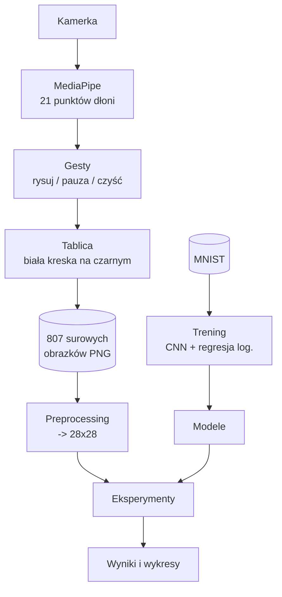

# *Writing in the Air* – przegląd projektu w 10 minut

Krótka wersja do szybkiego ogarnięcia całości. Szczegóły, fragmenty kodu
i pytania egzaminatora są w `technical-guide.md`.

---

## 1. O co chodzi

Sieć neuronowa wytrenowana na MNIST (cyfry pisane długopisem na papierze)
rozpoznaje je w ponad 99 %. Sprawdzamy, **ile traci, gdy dostaje cyfry
pisane palcem w powietrzu przed kamerką**, i **co najlepiej odzyskuje tę
stratę**: obróbka obrazu, augmentacja czy dotrenowanie na naszych danych.

Tablica sterowana gestami to tylko **narzędzie**: nią zebraliśmy własne dane
(807 cyfr od 4 osób) i nią robimy demo na żywo. Oceniane jest badanie.

---

## 2. Jak to działa – w jednym obrazku

Prościej: **palec → rysunek → obróbka do 28×28 → model z MNIST → wynik**.

---

## 3. Pliki – po jednym zdaniu

| Plik | Co robi |
|---|---|
| `config.py` | Wszystkie stałe w jednym miejscu: ziarna losowe, ścieżki, hiperparametry. |
| `gestures.py` | Z 21 punktów dłoni ustala, które palce są wyprostowane, i zamienia to na gest. |
| `whiteboard.py` | Kamerka + śledzenie dłoni + rysowanie na tablicy; z `--predict` to demo na żywo. |
| `collect_data.py` | Narzędzie do zbierania danych: zapisuje każdą narysowaną cyfrę jako PNG. |
| `data_utils.py` | Wczytuje MNIST i nasze cyfry (plus sztuczne dane do testów). |
| `preprocessing.py` | Zamienia surowy rysunek na obrazek 28×28 jak w MNIST, krok po kroku; tu też augmentacja. |
| `model.py` | Mała sieć konwolucyjna (CNN, ~104 tys. parametrów), zapis/odczyt modeli, predykcja. |
| `train.py` | Trenuje na MNIST regresję logistyczną, CNN i CNN z augmentacją, każde 3 razy. |
| `evaluate.py` | Metryki (dokładność, F1) i statystyka (przedziały ufności, test McNemara). |
| `ablation.py` | Główne eksperymenty na naszych danych: warianty obróbki, dotrenowanie, test na nowej osobie. |
| `analysis.py` | Rysuje wykresy i zapisuje najważniejsze liczby. |
| `metrics_analysis.py` | Sprawdza, czy różnice są istotne statystycznie; wyniki per osoba. |
| `error_analysis.py` | Analiza błędów: które cyfry są mylone i dlaczego. |
| `plotting.py` | Wspólny wygląd wszystkich wykresów. |

---

## 4. Co testujemy

**Obróbka obrazu (preprocessing)** – cztery warianty:

- **minimal** – tylko przycięcie i skalowanie do 28×28 (punkt odniesienia),
- **thickness** – + wyrównanie grubości kreski do grubości z MNIST,
- **centering** – + przesunięcie środka masy cyfry na środek obrazka,
- **full** – wszystko razem.

**Modele:** regresja logistyczna (prosty model liniowy), CNN, CNN trenowana
z augmentacją (losowe obroty, pogrubienia, zniekształcenia).

**Dodatkowo:** dotrenowanie na 70 % naszych danych oraz test na osobie,
której model nie widział (leave-one-writer-out).

Każdy eksperyment powtarzamy z 3 ziarnami losowymi i podajemy średnią.

---

## 5. Główne wyniki

| | Minimal | Thickness | Centering | Full |
|---|---|---|---|---|
| Regresja logistyczna | 55,5 % | 63,3 % | 74,6 % | 80,0 % |
| **CNN** | **96,5 %** | 97,5 % | 98,4 % | **99,5 %** |
| CNN z augmentacją | 94,3 % | 95,0 % | 97,6 % | 97,2 % |

Na MNIST CNN ma 99,3 %, a regresja logistyczna 92,3 %.

**Pięć zdań do zapamiętania:**

1. **Luka istnieje, ale jest mała:** CNN traci 2,8 punktu procentowego
   na naszych cyfrach (99,3 % → 96,5 %).
2. **Sama obróbka obrazu zamyka całą lukę** (99,5 %), bez żadnych naszych
   danych w treningu. Centrowanie daje więcej niż wyrównanie grubości.
3. **Model liniowy cierpi dużo bardziej**, bo nie radzi sobie z przesunięciem
   cyfry; CNN dzięki konwolucjom jest na to odporniejsza.
4. **Augmentacja zaszkodziła:** model zaczął mylić nasze jedynki
   z "daszkiem" z siódemkami. Przyczyna to hipoteza, nie sprawdziliśmy jej.
5. **Dotrenowanie dało 100 %, ale to nic nie znaczy:** model był już
   praktycznie bezbłędny przed nim (efekt sufitu).

**Skąd luka?** Nasze kreski po zmniejszeniu do 28×28 są dużo cieńsze niż
w MNIST (mediana 0,9–1,6 px u naszych osób vs 2,4 px w MNIST), a cyfry są różnie położone. Obróbka naprawia
dokładnie te dwie rzeczy.

---

## 6. Kluczowe pojęcia

| Pojęcie | Znaczenie |
|---|---|
| **Domain shift / luka domenowa** | Model działa gorzej na danych innych niż treningowe. |
| **MNIST** | Standardowy zbiór 70 tys. cyfr 28×28, na nim trenujemy. |
| **CNN** | Sieć konwolucyjna, uczy się lokalnych wzorów (krawędzie, łuki). |
| **Regresja logistyczna** | Najprostszy klasyfikator: jedna waga na piksel. Nasz punkt odniesienia. |
| **Preprocessing** | Obróbka obrazu przed podaniem go modelowi. |
| **Augmentacja** | Sztuczne zniekształcanie danych treningowych, żeby model był odporniejszy. |
| **Fine-tuning** | Dotrenowanie gotowego modelu na nowych danych. |
| **Ablacja** | Włączanie kroków po kolei, żeby zmierzyć wkład każdego z nich. |
| **Zero-shot** | Test bez żadnego dotrenowania na nowych danych. |
| **Ziarno losowe (seed)** | Ustalona losowość, żeby wynik dało się powtórzyć. |
| **Test McNemara** | Sprawdza, czy dwa modele naprawdę różnią się na tych samych obrazkach. |
| **Efekt sufitu** | Wynik jest już tak bliski 100 %, że nie da się zobaczyć poprawy. |

---

## 7. Ograniczenia (powiedzieć samemu)

Mało danych (807 cyfr, 4 osoby), czysta kreska z tablicy (prawdziwe pisanie
byłoby bardziej zaszumione), wyjaśnienie augmentacji to hipoteza,
a dotrenowanie i test na nowej osobie trafiły w sufit.

---

**Co dalej:** przeczytaj `technical-guide.md` – tam jest każdy plik
z kodem, uzasadnienie decyzji i 20 pytań egzaminatora z odpowiedziami.
