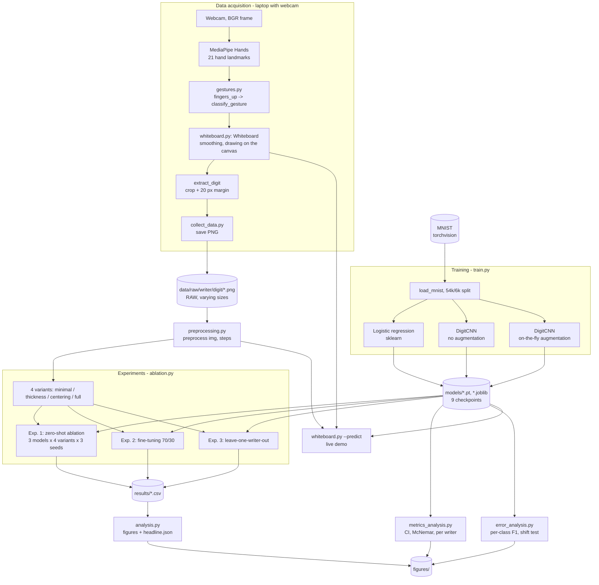
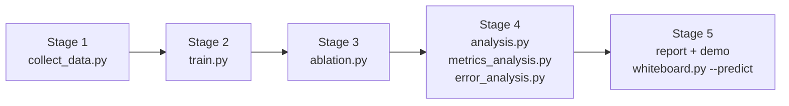

# Technical guide to *Writing in the Air*

This document has one goal: every team member should understand the code and
the results well enough to answer questions after the presentation with
confidence. It reads top to bottom, but section 10 (likely examiner
questions) also works on its own as a cheat sheet.

Every number below comes from a file in `results/` (official run of
7 November 2026, seeds 42/43/44, 807 of our digits). Unless stated otherwise,
a number is the mean over the 3 seeds.

---

## 0. The essentials in 60 seconds

**Research question.** How much accuracy does an MNIST-trained classifier lose
on digits written in the air with a finger, and which intervention (stroke
width normalisation, centre-of-mass alignment, training-time augmentation,
fine-tuning) closes that gap best?

**Key numbers** (worth memorising):

| What | Result | Source file |
|---|---|---|
| CNN on the MNIST test set | **99.33 %** | `results/mnist_test_runs.csv` |
| Logistic regression on the MNIST test set | 92.35 % | same |
| CNN on our data, minimal preprocessing | **96.53 %** | `results/ablation_summary.csv` |
| CNN domain gap | **2.80 points** (5.2× more errors) | `results/metrics/gap_closed.csv` |
| CNN, stroke width normalisation only | 97.48 % (closes 34 % of the gap) | same |
| CNN, centring only | 98.43 % (closes 68 % of the gap) | same |
| CNN, full preprocessing | **99.46 %** (closes the whole gap) | same |
| Augmented CNN, full preprocessing | 97.19 % (**worse** than without augmentation) | `results/ablation_summary.csv` |
| Logistic regression: minimal → full | 55.47 % → 79.97 % | same |
| Fine-tuning on 70 % of our data | 99.86 % → 100 % (ceiling effect) | same |

**Three conclusions, one sentence each:**

1. The domain gap is real, but small for the CNN (2.8 points) and huge for
   the linear model (36.9 points).
2. Preprocessing alone (stroke width + centring), without any of our data in
   training, closes the whole CNN gap. Centring contributes more than stroke
   width.
3. Augmentation hurt, and fine-tuning showed nothing because the model was
   already at the ceiling.

---

## 1. What the project is, and why the gesture whiteboard is not the point

The project is an **empirical study of domain shift**. The source domain is
MNIST: scanned digits written with a pen on paper. The target domain is our
digits drawn with a finger in front of a webcam.

The gesture-controlled whiteboard (`whiteboard.py`) is the **measuring
instrument**: we used it to collect our own dataset (807 images, 4 writers,
20 samples per digit; one writer has 207 instead of 200 because a few extra
samples of 0, 6 and 7 were saved and we kept them as they are). It is also
our live demo (`whiteboard.py --predict`). What is graded is the study: the
measured gap, the ablation and the error analysis.

Why is this a problem at all? Air-written digits differ from MNIST:

- the stroke has a fixed width set in the program, and after downscaling to
  28×28 it is **much thinner** than in MNIST (median 0.90–1.55 px vs
  2.44 px),
- you cannot "lift the pen", so connecting lines can appear,
- the hand trembles, and the proportions and position of the digit vary,
- every writer has their own style (e.g. the continental-European "1" with a
  long upstroke).

---

## 2. Architecture and data flow

### 2.1 Diagram (mermaid)



### 2.2 The same in ASCII (in case mermaid does not render)

```
 WEBCAM ──> MediaPipe (21 pts) ──> gestures.py ──> Whiteboard (canvas 0/255)
                                                        │ extract_digit()
                                                        v
                                     collect_data.py ──> data/raw/<writer>/<digit>/*.png
                                                        │   (raw, NOT 28x28)
                                                        v
 MNIST ──> train.py ──> models/ (logreg, cnn, aug) x 3 seeds
                │                       │
                │                       v
                │     preprocessing.preprocess(img, steps) -> 28x28 float32
                │                       │
                │                       v
                └──────────────> ablation.py ──> results/*.csv
                                        │
              ┌─────────────────────────┼──────────────────────────┐
              v                         v                          v
         analysis.py           metrics_analysis.py         error_analysis.py
     (figures, headline)     (CI, McNemar, per writer)  (F1, confusions, shift)
              └──────────────> figures/, results/ <────────────────┘

 Demo:  webcam -> Whiteboard -> extract_digit -> preprocess(FULL) -> CNN seed 42
```

### 2.3 Run order

```bash
python train.py              # ~1 h on a laptop CPU, 15-25 min on a Colab T4
python ablation.py           # experiments on our data
python analysis.py           # figures and results/headline.json
python metrics_analysis.py   # inference only, ~1-2 min
python error_analysis.py     # inference only, a few minutes
```

The key rule of the project: **no number is ever typed in by hand**.
`analysis.py` only reads the CSV files written by `train.py` and
`ablation.py`; the report quotes files in `results/`.

### 2.4 Contracts between modules

We agreed on two interfaces so that parts could be built in parallel:

```python
# preprocessing.py
def preprocess(img: np.ndarray, steps: list[str]) -> np.ndarray:
    """Raw grayscale drawing -> 28x28 float32, normalised like MNIST."""

# model.py
def predict(img: np.ndarray) -> tuple[int, float]:
    """img: 28x28 float32. Returns (digit, confidence)."""
```

### 2.5 Workflow step by step: what each script reads and writes

The whole project is five stages. Each stage writes files to disk and the
next one reads them, so stages can be run separately and nothing has to be
kept in memory between them.



| Stage | Script | Reads | Writes | Time |
|---|---|---|---|---|
| 1. Data collection | `collect_data.py --writer <name>` | webcam image | `data/raw/<writer>/<digit>/*.png` (raw, varying sizes) | depends on the writer |
| 2. Training on MNIST | `train.py` | MNIST (downloaded by torchvision to `data/mnist/`) | `models/cnn_mnist_seed4X.pt`, `models/cnn_aug_seed4X.pt`, `models/logreg_seed4X.joblib`, `results/history_*.csv`, `results/mnist_test_runs.csv` | ~1 h on CPU |
| 3. Experiments | `ablation.py` | `data/raw/`, all checkpoints in `models/` | `data/labels.csv`, `results/ablation_runs.csv`, `results/ablation_summary.csv`, `results/lowo_*.csv`, `results/per_class_f1.csv`, confusion matrices and error galleries in `figures/` | a few minutes |
| 4a. Figures and headline numbers | `analysis.py` | CSVs from stages 2 and 3, MNIST, `data/raw/` (for domain statistics) | `figures/*.png/.pdf`, `results/domain_stats.csv`, `results/headline.json` | ~1 min |
| 4b. Statistics | `metrics_analysis.py` | checkpoints, `data/raw/`, `results/domain_stats.csv`, `results/mnist_test_runs.csv`, `results/ablation_runs.csv`, `results/lowo_runs.csv` | `results/metrics/*.csv` (incl. `predictions.csv`), `figures/metrics/` | 1–2 min |
| 4c. Error analysis | `error_analysis.py` | `results/metrics/predictions.csv`, checkpoints, MNIST, `data/raw/` | `results/analysis/*.csv`, `figures/analysis/` | a few minutes |
| 5. Demo | `whiteboard.py --predict` | webcam, `models/cnn_mnist_seed42.pt` | nothing (on-screen window only) | live |

Two things worth being able to say:

- **Stages 3 and 4 do not train from scratch** (apart from the short
  fine-tuning in `ablation.py`). They load the saved checkpoints, so after a
  change to preprocessing only stages 3 and 4 need to be re-run, with no
  retraining.
- **Order within stage 4 matters:** `analysis.py` writes `domain_stats.csv`,
  which `metrics_analysis.py` needs, and `metrics_analysis.py` must run before
  `error_analysis.py`, because the latter reads
  `results/metrics/predictions.csv` (one row per image × model × variant ×
  seed).

Stages 2–4 can also be run in one go on Colab (`airwrite_colab.ipynb`). To
check that everything works without waiting an hour, use `--quick` (small
training run, outputs in `*/smoke/`) and `--synthetic` (stand-in data,
outputs in `*/synthetic/`).

### 2.6 Who imports whom

Almost every file imports `config.py`, so it is left out of the table.

| File | Imports from the project |
|---|---|
| `gestures.py` | only constants from `config` |
| `whiteboard.py` | `gestures`; in `--predict` mode also `model` and `preprocessing` |
| `collect_data.py` | `gestures`, `whiteboard` |
| `preprocessing.py` | only `config` |
| `model.py` | only `config` |
| `data_utils.py` | `preprocessing` (skeleton and elastic deformation for synthetic data) |
| `evaluate.py` | `model`, `plotting` |
| `train.py` | `data_utils`, `evaluate`, `model`, `preprocessing` (augmentation) |
| `ablation.py` | `train` (fine-tuning, seeds), `data_utils`, `evaluate`, `model`, `preprocessing`, `plotting` |
| `analysis.py` | `data_utils`, `preprocessing`, `plotting` |
| `metrics_analysis.py` | `ablation` (variant list), `data_utils`, `evaluate`, `model`, `preprocessing`, `plotting` |
| `error_analysis.py` | `data_utils`, `model`, `preprocessing`, `plotting` |

Layers, bottom up:

1. **Foundation:** `config.py` (constants), `plotting.py` (figure style).
2. **Library:** `preprocessing.py`, `model.py`, `data_utils.py`,
   `evaluate.py`, `gestures.py`. They run nothing on their own, they only
   provide functions.
3. **Scripts:** `train.py`, `ablation.py`, `analysis.py`,
   `metrics_analysis.py`, `error_analysis.py`, `collect_data.py`,
   `whiteboard.py`. Each has a `main()` and command-line arguments.

Note: `whiteboard.py` imports `model` and `preprocessing` only inside
`LivePredictor`, i.e. only in `--predict` mode. So plain drawing and data
collection work without PyTorch installed.

### 2.7 The path of one digit, from finger to prediction

What exactly happens to one drawn "7":

1. The **webcam** gives a frame (we request 960×540, BGR). The image is
   mirrored.
2. **MediaPipe** returns 21 hand landmarks (x, y in the range 0–1).
3. **`gestures.fingers_up`** gives e.g. `[0, 1, 0, 0, 0]`, and
   **`classify_gesture`** turns that into `draw`.
4. **`Whiteboard.update`** takes the index fingertip, averages it over the
   last 5 frames and draws a 12 px wide line segment on the black canvas.
5. A fist ends the drawing. **`extract_digit`** crops the rectangle around
   the stroke with a 20 px margin, e.g. 180×260 px.
6. **`collect_data.py`** saves it as `data/raw/mateusz/7/mateusz_7_012.png`.
   Nothing has been resized yet.
7. **`preprocess(img, FULL_STEPS)`**:
   Otsu binarisation → stroke width set to 12 % of the digit's longer side →
   longer side scaled to 20 px and pasted into 28×28 → centre of mass moved
   to the centre → normalisation (x − 0.1307) / 0.3081.
   Result: a 28×28 float32 array.
8. **`DigitCNN`**: 1×28×28 → 32×14×14 → 64×7×7 → 128×3×3 → 1152 → 10 logits.
9. **Softmax** gives 10 probabilities; the argmax is the prediction, e.g.
   "7" with confidence 0.99.
10. In the experiments the prediction goes to `compute_metrics` and into a
    CSV row; in the demo it is drawn on screen together with the 28×28 image
    from step 7.

---

## 3. The files one by one

### 3.1 `config.py` – shared constants

One place for every number that could otherwise drift between files: seeds,
paths, image sizes, training hyperparameters, webcam settings, MediaPipe
landmark ids.

The most important values:

```python
SEED = 42
SEEDS = (42, 43, 44)          # every experiment 3x, we report mean ± std
IMG_SIZE = 28
DIGIT_BOX = 20                # MNIST: digit fitted into a 20x20 box, then 28x28
MNIST_MEAN, MNIST_STD = 0.1307, 0.3081
EPOCHS, BATCH_SIZE, LEARNING_RATE = 8, 128, 1e-3
VAL_SIZE = 6000               # 54k train / 6k validation
FINETUNE_FRACTION, FINETUNE_EPOCHS, FINETUNE_LR = 0.7, 15, 1e-4
STROKE_THICKNESS = 12         # stroke width on the canvas (webcam px)
SMOOTHING_WINDOW = 5          # average of the last 5 fingertip positions
CROP_MARGIN = 20              # margin when cropping the digit
```

`redirect_outputs(subdir)` redirects outputs to a subfolder (`smoke/`,
`synthetic/`). It works because the other modules read `config.RESULTS_DIR`
etc. **at call time**, not at import time. So `--quick` and `--synthetic`
test runs never overwrite the real results.

### 3.2 `gestures.py` – gesture logic (no camera)

It deliberately **imports neither MediaPipe nor OpenCV** and works on a list
of 21 `(x, y)` points. That is why it can be tested without a webcam:
`python gestures.py` runs a self-test on synthetic hands (6 cases, all pass).

Two functions:

```python
def fingers_up(landmarks):
    # thumb: is the tip further from the pinky base than the IP joint?
    tip_far = _distance(landmarks[THUMB_TIP], landmarks[PINKY_MCP])
    ip_far  = _distance(landmarks[THUMB_IP],  landmarks[PINKY_MCP])
    state.append(1 if tip_far > ip_far else 0)
    # other fingers: is the tip higher (smaller y) than the PIP joint?
    for tip, pip in ((INDEX_TIP, INDEX_PIP), ...):
        state.append(1 if landmarks[tip][1] < landmarks[pip][1] else 0)
```

Why is the thumb different? The thumb moves sideways, not up. Comparing
distances to the pinky base works the same for the left and the right hand
(the image is mirrored).

```python
def classify_gesture(state):
    _, index, middle, ring, pinky = state       # thumb ignored
    if index and not middle and not ring and not pinky:  return MODE_DRAW   # pointing
    if index and middle and not ring and not pinky:      return MODE_MOVE   # two fingers
    if not index and not middle and not ring and not pinky: return MODE_PAUSE  # fist
    if index and middle and ring and pinky:              return MODE_CLEAR  # open palm
    return MODE_NONE
```

The thumb is ignored for drawing because most people do not tuck it in when
pointing.

### 3.3 `whiteboard.py` – hand tracking and canvas

Three classes:

- **`HandTracker`** wraps MediaPipe Hands (one hand, confidence thresholds
  0.7 / 0.6). It converts the BGR frame (OpenCV) to RGB (MediaPipe) and
  returns 21 points in [0, 1].
- **`Whiteboard`** holds the canvas: a **grayscale image, white stroke on a
  black background**, i.e. already in the MNIST convention (no colour
  inversion needed).
- **`LivePredictor`** for the demo: loads `cnn_mnist_seed42.pt` and uses
  **exactly the same** `preprocess(..., FULL_STEPS)` as the experiments.

The heart of drawing, `Whiteboard.update()`:

```python
if landmarks is None:          # the hand disappeared
    self._end_stroke()         # otherwise we'd get a line to wherever the hand reappears
    ...
self.mode = classify_gesture(fingers_up(landmarks))
nx, ny = landmarks[config.INDEX_TIP]                 # index fingertip
raw = (int(nx * self.width), int(ny * self.height))
...
cursor = self._smooth(raw)                           # average of the last 5 positions
if self._prev_point is not None:
    cv2.line(self.canvas, self._prev_point, cursor, color=255,
             thickness=config.STROKE_THICKNESS, lineType=cv2.LINE_AA)
```

- **Smoothing** (moving average of 5 positions, `deque(maxlen=5)`): MediaPipe
  jitters slightly between frames; averaging gives smoother lines at the cost
  of a tiny delay.
- **We draw segments between consecutive points**, not single dots, so the
  stroke stays continuous even with fast movement.
- **`LINE_AA`** (anti-aliasing) produces grey edges, which is why
  preprocessing has a binarisation step.

`extract_digit()` crops the bounding rectangle of the stroke plus a 20 px
margin and **deliberately does not resize to 28×28**. The raw drawing is
saved so that every preprocessing variant starts from the same image. If we
resized at collection time, the ablation would be meaningless.

Demo (`--predict`): a prediction fires once, when the hand stops drawing
(fist, two fingers, or hand out of view); the `dirty` flag makes sure it is
not recomputed every frame. The `p` key toggles full/minimal preprocessing on
the same drawing, which shows the effect of preprocessing live. The corner
shows the 28×28 image the model actually receives.

### 3.4 `collect_data.py` – data collection

Uses `HandTracker` and `Whiteboard`. It walks through digits 0–9; SPACE saves
the drawing as a PNG:

```
data/raw/<writer>/<digit>/<writer>_<digit>_<nnn>.png
```

Numbering continues (`count_existing() + 1`), so you can stop and come back
without overwriting anything. A green border means the digit already has
enough samples. Instruction to writers: **write normally, do not imitate
MNIST**, because we want to measure the real difference.

### 3.5 `data_utils.py` – data loading

- `load_mnist(train)` – MNIST from torchvision as uint8 NumPy arrays.
- `scan_raw_folder()` – a list of `(path, label, writer)`, **sorted**, so
  that later splits are reproducible. The label and writer come from the
  folder names.
- `load_airwrite()` – loads the raw PNGs (varying sizes!) and regenerates
  `data/labels.csv`.
- `make_synthetic_airwrite()` – **synthetic** "air digits" made from MNIST
  test images (skeleton → slant → thick stroke → connecting lines → elastic
  tremor). Used only to test the pipeline before we had real data.
  **These numbers never go into the report.**

### 3.6 `preprocessing.py` – the heart of the study

Every step can be switched on or off separately, because the ablation
measures them one by one. Steps always run in this order, regardless of the
order in the list:

```python
ALL_STEPS = [
    "binarize",             # Otsu threshold
    "normalize_thickness",  # stroke width relative to digit size
    "resize_padded",        # fit into 20x20 keeping aspect ratio, pad to 28x28
    "center_by_mass",       # centre of mass to the image centre
    "normalize_pixels",     # MNIST mean/std
]
MINIMAL_STEPS = ["resize_padded", "normalize_pixels"]
FULL_STEPS = list(ALL_STEPS)
TARGET_STROKE_RATIO = 0.12
```

The steps:

**`binarize`** – Otsu's threshold (`cv2.THRESH_OTSU`) picks the threshold
that best separates the two brightness levels. It removes the grey edges left
by anti-aliasing so that morphological operations work on a clean mask.

**`normalize_thickness`** – the most interesting step. First we measure the
stroke width:

```python
def estimate_stroke_width(img):
    dist = cv2.distanceTransform(binary, cv2.DIST_L2, 5)   # distance to background
    centre = skeletonize(binary) > 0                       # centre line
    return float(2 * np.median(dist[centre]))
```

On the skeleton (the centre line of the stroke) the distance transform equals
half the local stroke width, so width = 2 × median. We then compare it with
the target `0.12 × the digit's longer side` and **erode** (make thinner) or
**dilate** (make thicker) with a disc whose size is the difference. If erosion
would remove more than 75 % of the ink (thin parts could vanish), the kernel
is reduced.

Why 0.12? After scaling the longer side to 20 px this gives
0.12 × 20 = 2.4 px, and the median MNIST stroke width is 2.44 px. The value
was fixed **before** data collection. `metrics_analysis.py` tries 0.06–0.18
only as a robustness check (98.5–99.5 % on average); we did not choose the
value from it, because that would be tuning on the test set.

Why erode/dilate the original rather than redraw the skeleton with a thicker
brush? The skeleton has small spurs that turn into blobs when thickened.

Why does this step come **before** resizing? Morphology at full resolution is
precise; at 28×28 there are only a few possible widths.

**`resize_padded`** – crops the digit, scales the **longer side to 20 px
keeping the aspect ratio** (`INTER_AREA` gives soft edges like MNIST), and
pastes it in the middle of a black 28×28 image. Without keeping the aspect
ratio a "1" would be stretched into a block. This is exactly how MNIST itself
was built (LeCun et al., 1998).

**`center_by_mass`** – computes the intensity-weighted centre of mass and
shifts the image so that it lands at the centre (13.5, 13.5). Also as in the
original MNIST:

```python
cy = (ys * img).sum() / total
cx = (xs * img).sum() / total
shift = np.float32([[1, 0, centre - cx], [0, 1, centre - cy]])
return cv2.warpAffine(img, shift, ...)
```

Note: `resize_padded` centres the *bounding box*, while `center_by_mass`
centres the *ink mass*. For a digit like 7 (lots of ink at the top) these are
two different things.

**`normalize_pixels`** – scale to [0, 1], then `(x − 0.1307) / 0.3081`. The
network was trained on data normalised this way, so this step is in every
variant, including "minimal".

**`augment()`** (training only, on 28×28 uint8 MNIST images):

| Transformation | Parameters | What it simulates |
|---|---|---|
| dilation | 50 % chance, 2×2 or 3×3 kernel | thicker stroke |
| rotation | ±10° | tilted hand |
| scale | 0.9–1.1 | different size |
| shift | ±2 px | imprecise placement |
| elastic deformation | 50 % chance, α = 34, σ = 4 (Simard et al., 2003) | hand tremor |

### 3.7 `model.py` – the CNN

```python
def _block(c_in, c_out):
    return nn.Sequential(
        nn.Conv2d(c_in, c_out, kernel_size=3, padding=1, bias=False),
        nn.BatchNorm2d(c_out),
        nn.ReLU(inplace=True),
        nn.MaxPool2d(2),
    )

class DigitCNN(nn.Module):
    def __init__(self, dropout=0.3):
        self.features = nn.Sequential(_block(1, 32), _block(32, 64), _block(64, 128))
        self.classifier = nn.Sequential(nn.Flatten(), nn.Dropout(dropout),
                                        nn.Linear(128 * 3 * 3, 10))
```

Tensor shapes and parameter count:

| Layer | Output | Parameters |
|---|---|---|
| input | 1 × 28 × 28 | – |
| block 1 (3×3 conv, 32 filters, BN, ReLU, maxpool) | 32 × 14 × 14 | 288 + 64 |
| block 2 (64 filters) | 64 × 7 × 7 | 18,432 + 128 |
| block 3 (128 filters) | 128 × 3 × 3 | 73,728 + 256 |
| flatten + dropout 0.3 | 1152 | – |
| linear | 10 (logits) | 11,530 |
| **total** | | **104,426** (~104k) |

Notes:
- `bias=False` in the convolutions, because BatchNorm has its own shift (β),
  so a bias would be redundant.
- 7 → 3 at the third pooling (rounded down).
- The output is **logits**; softmax is applied only in `predict_batch`,
  because `CrossEntropyLoss` does log-softmax itself.
- `forward` adds the channel dimension if the input has shape (N, 28, 28).

Other functions: `checkpoint_path`, `save_model`, `load_model` (we save only
the `state_dict`, and load it with `weights_only=True`, which is safe),
`predict_batch` (inference in batches of 512, `@torch.no_grad()`), `predict`
(the contract from CLAUDE.md; the model is loaded lazily on the first call
and cached).

### 3.8 `train.py` – training on MNIST

Trains three models for each of the three seeds:

1. **Logistic regression** (scikit-learn, `max_iter=200`) on the 784 raw,
   normalised pixels. Baseline: a linear model with no knowledge of image
   structure.
2. **CNN** without augmentation (`cnn_mnist_seed*.pt`).
3. **CNN with augmentation** (`cnn_aug_seed*.pt`).

Key parts:

```python
def set_seed(seed):
    random.seed(seed); np.random.seed(seed); torch.manual_seed(seed)
    torch.cuda.manual_seed_all(seed)
    torch.backends.cudnn.deterministic = True
    torch.backends.cudnn.benchmark = False
```

- `split_train_val` – a seed-dependent random 54,000 / 6,000 split. The MNIST
  test set (10,000) is not used for any decision, only for reporting.
- `DigitDataset` – augmentation **on the fly** (`__getitem__`), on uint8
  before normalisation, so every epoch sees different distortions. One random
  generator for the whole dataset; with `num_workers=0` this is reproducible.
- `DataLoader(..., shuffle=True, generator=torch.Generator().manual_seed(seed))`
  – batch order also depends on the seed.
- `fit()` – **Adam**, lr = 1e-3, **cosine annealing** over 8 epochs,
  `CrossEntropyLoss`. Saves the history (train and validation loss/accuracy,
  epoch time) to `results/history_*.csv`.
- `fine_tune()` – continued training on our data: lr = 1e-4 (10× smaller),
  15 epochs, batch 32. We have a few hundred images, so we want to *adjust*
  the model, not retrain it (and not forget MNIST).
- `upsert_rows()` – appends rows to a CSV, replacing old rows with the same
  key. One model/seed can be re-run without deleting the rest.

Measured times (CPU): ~32 s per CNN epoch, ~38 s with augmentation, ~4.4 min
for a full CNN training run, ~50 s for logistic regression. Final validation
accuracy: CNN 99.22–99.55 %; augmented CNN 98.90–99.17 %. Training accuracy
with augmentation is lower (97.1 % vs 99.8 %), which is normal: the training
data is harder, while validation has no augmentation.

### 3.9 `evaluate.py` – metrics and statistics

- `compute_metrics` – accuracy, macro-F1 and F1 per digit (sklearn).
- `summarise` – turns per-seed rows into `mean` and `std` per configuration.
- `save_confusion_matrix` – confusion matrix to `figures/`.
- `bootstrap_accuracy_ci` – 95 % confidence interval by bootstrap (2,000
  resamples of images with replacement; with several seeds the same images
  are used for all seeds).
- `mcnemar_test` – exact McNemar test: two models on the same images; only
  images where they disagree count (b = A right/B wrong, c = A wrong/B
  right); if the models are equally good, b ~ Binomial(b + c, 0.5).
- `gap_closed` – the share of the gap closed:
  `(acc_variant − acc_minimal) / (acc_MNIST − acc_minimal)`;
  0 = no improvement, 1 = as good as on MNIST, > 1 = better than on MNIST.
- `rule_of_three_upper` – 95 % upper bound on the error rate; with 0 errors
  the "rule of three" 3/n, otherwise the Wilson upper bound.

### 3.10 `ablation.py` – all experiments on our data

```python
VARIANTS = {
    "minimal":   ["resize_padded", "normalize_pixels"],
    "thickness": ["binarize", "normalize_thickness", "resize_padded", "normalize_pixels"],
    "centering": ["resize_padded", "center_by_mass", "normalize_pixels"],
    "full":      ["binarize", "normalize_thickness", "resize_padded",
                  "center_by_mass", "normalize_pixels"],
}
```

Three experiments:

1. **Zero-shot** (`zero_shot`): 3 models × 4 variants × 3 seeds = 36 runs on
   all 807 images. **No retraining**; only test-time preprocessing changes.
   That is why the same checkpoints suffice.
2. **Fine-tuning** (`finetune_split`): stratified 70/30 split
   (`train_test_split(..., stratify=labels, random_state=seed)`), tested on
   the 30 % (243 images) before and after fine-tuning on the 70 %. Variant
   `full`.
3. **Leave-one-writer-out** (`leave_one_writer_out`): fine-tune on 3 writers,
   test on the fourth, for every writer and seed.

Writes `ablation_runs.csv`, `ablation_summary.csv`, `lowo_*.csv`,
`per_class_f1.csv`, confusion matrices and galleries of misclassified digits.
The `--synthetic` flag prints a big warning and writes to
`results/synthetic/`.

### 3.11 `analysis.py` – figures and headline numbers

Recomputes nothing from the models; it reads the CSV files. It draws learning
curves, example digits per writer, the successive preprocessing steps,
augmentation examples, stroke-width and fill-ratio distributions (MNIST vs
ours), and the ablation and LOWO plots. It writes `results/domain_stats.csv`
and `results/headline.json`.

Domain statistics:
- `stroke_width` – stroke width computed on a 4× upscaled image (28×28 has
  too few possible values), then divided by 4.
- `fill_ratio` – share of ink pixels (> 0.5).

### 3.12 `metrics_analysis.py` – statistics of the results

Extended zero-shot evaluation: confidence intervals, McNemar tests for 8 pairs
of comparisons with **Holm-Bonferroni** correction (8 tests per seed),
per-writer results, most frequent confusions, model confidence on errors,
sensitivity to `TARGET_STROKE_RATIO`, a ceiling-effect check, stroke width
after augmentation. Inference on the saved checkpoints only, ~1–2 min.
Outputs in `results/metrics/` and `figures/metrics/`.

### 3.13 `error_analysis.py` – error analysis

Per-digit F1 for every model and variant, how the confusions change from
minimal to full, a gallery of the main confusions (raw drawing / minimal
input / full input), which writers' 1s are read as 7s, and the **shift test
on MNIST**: it shifts the test digits by k pixels (average over 4 directions)
and compares the CNN with logistic regression. This is the experiment that
explains why centring helps the linear model so much more.

### 3.14 `plotting.py`, `figs.py`, `derive.py`

- `plotting.py` – shared figure style (colour-blind-friendly palette, each
  writer always has the same colour), saving as PNG + PDF, helpers for
  confusion matrices, bars with error bars, histograms, digit grids and
  galleries.
- `figs.py` – extra figures for the report (pipeline diagram, zoomed axes,
  per-writer plot, sensitivity). Input: a folder of CSV files.
- `derive.py` – extra numbers for the report that are not directly in the
  CSVs (e.g. how many images the thickness step fixed for each writer).
  Writes `derived.json`.

### 3.15 `airwrite_colab.ipynb`

A notebook that clones the repo on Colab, checks for a GPU, runs
`train.py → ablation.py → analysis.py` and zips `results/`, `figures/` and
`models/`. The official run was done on CPU anyway, because the time was
acceptable.

---

## 4. Model and training: decisions and justification

| Decision | Justification |
|---|---|
| Small CNN (~104k parameters), 3 conv blocks | The project is about the data, not the architecture. MNIST does not need a bigger network (99.3 %). It has to be trained 6 times (2 variants × 3 seeds). |
| 3×3 convolutions + max-pooling | Local patterns (edges, curves) + partial translation invariance. Exactly what logistic regression lacks. |
| BatchNorm | More stable and faster training, less sensitivity to the learning rate. |
| Dropout 0.3 before the linear layer | Regularisation, less overfitting. |
| Adam, lr 1e-3 | Standard choice, works without tuning. |
| Cosine annealing over 8 epochs | Smoothly decreasing lr, a better end of training without a hand-made schedule. |
| 8 epochs | Validation curves flatten earlier, and each epoch takes ~32 s on CPU. |
| 6k validation split from MNIST train | The MNIST test set stays untouched for the report. |
| Logistic regression baseline | A linear, pixel-by-pixel model. Shows how much the architecture affects robustness to domain shift. |
| Fine-tuning lr 1e-4, 15 epochs | Little data: we want to adjust, not retrain. |
| 3 seeds, mean ± std | The std shows training noise; required by CLAUDE.md. |

---

## 5. Experiments and what the results mean

### 5.1 Full zero-shot ablation table (807 images)

| Model | Minimal | Thickness | Centering | Full |
|---|---|---|---|---|
| Logistic regression | 55.47 % | 63.28 % | 74.56 % | 79.97 % |
| CNN | 96.53 % | 97.48 % | 98.43 % | **99.46 %** |
| Augmented CNN | 94.34 % | 94.96 % | 97.56 % | 97.19 % |

For comparison, on the MNIST test set: logreg 92.35 %, CNN 99.33 %,
augmented CNN 99.12 %.

95 % confidence intervals (bootstrap) for the CNN: minimal 95.5–97.5 %,
full 99.0–99.8 %. Errors per seed: 28 → 20.3 → 12.7 → 4.3.

### 5.2 How to read the ablation

- **Centring > stroke width.** For the CNN, centring closes 68 % of the gap,
  stroke width 34 %, together 105 % (i.e. slightly better than on MNIST, but
  within the confidence interval, so we say "closes the whole gap", not
  "better than MNIST").
- **Significance (McNemar with Holm):** minimal → centering and
  minimal → full are significant for all 3 seeds. Minimal → thickness is
  **not** significant for any seed, so the stroke-width step alone is a
  trend, not a proven effect at this data size. We say so openly.
- **Why does the linear model suffer more?** Logistic regression has one
  weight per pixel. A digit shifted by 2 pixels lands on weights learned for
  other digits. We tested this directly on MNIST:

| Shift (px) | 0 | 1 | 2 | 3 | 4 |
|---|---|---|---|---|---|
| CNN | 99.33 % | 99.20 % | 98.22 % | 94.97 % | 85.48 % |
| Logistic regression | 92.35 % | 86.19 % | 62.44 % | 35.00 % | 18.56 % |

  2 px costs the CNN ~1 point and the linear model ~30 points. The CNN is not
  fully invariant either (it drops at 3–4 px), which is why centring helps it
  too.

### 5.3 Domain statistics – what exactly differs

| | MNIST | Our writers |
|---|---|---|
| median stroke width (px at 28×28) | 2.44 | 0.90–1.55 |
| median fill ratio (share of ink) | 0.130 | 0.052–0.081 |

The writer with the thinnest stroke (roman, 0.90 px) is the hardest at
minimal: CNN 92.9 % vs 97.2–98.3 % for the others. After full preprocessing:
99.2 %, the same as the others (99.0–99.8 %). The step that targets the
measured difference closes the gap for the writer where that difference is
largest.

### 5.4 Most frequent CNN confusions (errors per seed)

| True → predicted | Minimal | Full | Interpretation |
|---|---|---|---|
| 6 → 5 | 6.33 | 0.33 | long upper stroke, small low loop |
| 7 → 1 | 6.00 | 0 | narrow 7 with a short top bar |
| 1 → 7 | 3.67 | 1.67 | "1" with an upstroke flag (European style) |
| 9 → 3 | 3.67 | 0.33 | open loop of the 9 |

1 → 7 survives preprocessing because it comes from **writing style**, not
from stroke width or position. No normalisation step can fix that.

### 5.5 Why augmentation hurt (hypothesis)

The augmented CNN is worse on our data at every variant (97.19 % vs 99.46 %
at full, McNemar significant for all seeds), even though on MNIST it is
almost as good (99.12 % vs 99.33 %). Almost the whole difference is one
confusion: **1s read as 7s** (18 errors per seed at full; F1 for digit 1:
0.84 vs 0.985). It is concentrated in writers with the longest "flag" on
their 1 (45 % of kirill's 1s, 27 % of mateusz's, 5 % of kacper's).

Two measured facts point to a cause, but **this is a hypothesis, not a
result**:

1. Augmentation thickens the training strokes (median 2.44 → 3.24 px), while
   our strokes are thinner than MNIST. Augmentation moved the training data
   away from ours along exactly the axis where the difference is largest.
2. Rotation and elastic deformation turn some MNIST 7s into near-vertical
   strokes with a short slanted top, which looks very much like our flagged 1.

We did not run the confirming experiment (training with each augmentation
separately). The general lesson: augmentation must mimic the real target
domain; our whiteboard produces clean, even strokes, while the augmentation
was designed for noisy data.

### 5.6 Fine-tuning and LOWO: ceiling effect

- **Fine-tuning:** on the 243 test images the CNN makes 0, 1 and 0 errors
  *before* fine-tuning and 0 *after*. With 0 errors in 243 images the 95 %
  upper bound on the error rate is still 1.2 % (rule of three). So "100 %"
  means "no measurable difference", not "fine-tuning solved the problem".
- **LOWO:** before fine-tuning 99.0–99.8 % on each held-out writer (0–2
  errors in 200), after 99.4–100 %.

Both experiments start from a model that, with full preprocessing, is already
at the ceiling, so they cannot rank the interventions. A more informative
version (LOWO at minimal, where a gap remains) was not run.

### 5.7 Model confidence

The CNN's wrong answers have lower confidence than its correct ones (0.68 vs
0.96 at minimal), but 17 % of the errors at minimal have confidence ≥ 0.9. A
confidence threshold would catch most errors, but not all. Important for the
demo: a confident answer is not always a correct one.

---

## 6. Reproducibility

- **Seeds:** `config.SEEDS = (42, 43, 44)`, set in `set_seed()` for `random`,
  NumPy and PyTorch; cuDNN in deterministic mode; seeded DataLoader and
  augmentation generators; `num_workers=0`.
- **Splits:** `scan_raw_folder()` sorts the files, `train_test_split` gets
  `random_state=seed`, and the MNIST split also depends on the seed.
- **Library versions:** pinned in `requirements.txt` for Python 3.11
  (e.g. `torch==2.5.1`, `numpy==1.26.4`, `scikit-learn==1.5.2`,
  `mediapipe==0.10.21`, `opencv-contrib-python==4.10.0.84`). MediaPipe 0.10.21
  has no wheels for Python 3.13+, and newer releases removed the
  `mp.solutions` API we use, so that version is pinned on purpose.
- **Checkpoints:** all 9 (3 models × 3 seeds) are committed in `models/`, so
  `metrics_analysis.py` and `error_analysis.py` reproduce the results without
  retraining.
- **No hand-typed numbers:** every number in the report comes from a file in
  `results/` generated by code in the repo. Synthetic and `--quick` outputs go
  to separate folders that are in `.gitignore`.
- **Data:** the raw drawings are in the repo (`data/raw/`); `data/labels.csv`
  is generated automatically.

A caveat, in case someone asks: bit-for-bit reproducibility is only
guaranteed on the same hardware and versions (CPU vs GPU may differ in the
last decimal places). The official run was on CPU.

---

## 7. Limitations (say them before anyone asks)

1. **Little data:** 807 images, 4 writers, one session per writer. One error
   is 0.12 points, which is why we compute confidence intervals and McNemar
   tests.
2. **Clean strokes:** the whiteboard draws a constant-width anti-aliased,
   smoothed line. That is probably why the CNN gap is small (2.8 points); a
   real stylus or touch screen would be noisier.
3. **Each writer used their own webcam**, so conditions were not identical
   (which is also realistic).
4. **Augmentation:** the explanation is a hypothesis, not tested by an
   ablation.
5. **Ceiling effect:** fine-tuning and LOWO cannot tell anything apart at
   this data size.
6. **"Minimal" is not zero preprocessing:** it includes the aspect-preserving
   crop and pixel normalisation, because the network needs a 28×28 input on
   the same scale as in training. A gap measured without them would be
   bigger, but would not say anything interesting.

---

## 8. How the demo works and what can go wrong

Run: `python whiteboard.py --predict` (with the `.venv` with Python 3.11
activated).

- index finger – draw, fist – pause, two fingers – move the cursor without
  drawing, open palm – clear,
- the prediction appears when you stop drawing (big digit in the top right
  corner, top-3 probabilities, 28×28 preview),
- `p` toggles full/minimal on the same drawing (a good moment to show what
  preprocessing does), `c` clears, `q` quits.

Possible problems: wrong webcam (`CAMERA_INDEX` in `config.py`), poor lighting
(MediaPipe loses the hand), ragged strokes (increase `SMOOTHING_WINDOW`), and
on Windows running `whiteboard.py` without `python` opens VS Code instead of
the script. Rehearse in the presentation room, under its lighting.

---

## 9. Glossary (EN → PL)

| English | Polish |
|---|---|
| domain shift / domain gap | przesunięcie domeny / luka domenowa |
| source / target domain | domena źródłowa / docelowa |
| zero-shot evaluation | test bez dotrenowania |
| fine-tuning | dotrenowanie |
| ablation study | ablacja |
| stroke-width normalisation | normalizacja grubości kreski |
| centre-of-mass alignment | centrowanie po środku masy |
| confidence interval | przedział ufności |
| paired significance test (McNemar) | test istotności dla par |
| multiple-comparison correction (Holm) | poprawka na wielokrotne testowanie |
| ceiling effect | efekt sufitu |
| leave-one-writer-out (LOWO) | test na pominiętej osobie |
| translation invariance | niezmienniczość na przesunięcie |
| random seed | ziarno losowe |
| skeleton, distance transform | szkielet, transformata odległości |
| erosion, dilation | erozja, dylatacja |

---

## 10. Likely examiner questions and answers

Each answer ends with a short sentence in quotes that can be said as is.

**1. What is the main result of the project?**
The MNIST-trained CNN gets 99.33 % on MNIST and 96.53 % on our digits with
minimal preprocessing, a 2.8-point gap (5× more errors). Stroke-width
normalisation and centre-of-mass alignment together close the gap completely
(99.46 %), without any of our data in training.
*"The MNIST CNN loses 2.8 points on air-written digits, and test-time
preprocessing alone, stroke normalisation plus centre-of-mass alignment,
closes the whole gap."*

**2. Why didn't you collect the data directly at 28×28?**
Because the ablation compares preprocessing variants, and every variant must
start from the same raw image. Resizing at collection time would have "baked"
one variant into the data, and it could no longer be measured.
*"Every preprocessing variant must start from the same raw image, otherwise
the ablation would be meaningless."*

**3. How do you know you did not tune preprocessing on the test set?**
`TARGET_STROKE_RATIO = 0.12` was chosen before data collection, from MNIST's
stroke width (0.12 × 20 px = 2.4 px ≈ 2.44 px in MNIST). The 0.06–0.18
sensitivity curve is shown only as a robustness check; results change little
(98.5–99.5 %), and we did not pick the value from it. The preprocessing steps
reproduce the procedure that created MNIST.
*"The ratio was fixed from MNIST statistics before data collection; the
sensitivity curve is a robustness check, not a tuning step."*

**4. Why does centring help the linear model much more than the CNN?**
Logistic regression has one weight per pixel, so a shifted digit lands on the
wrong weights. Convolutions and max-pooling make the CNN partially
translation-invariant. Our shift test on MNIST confirms it: 2 px costs the
linear model ~30 points and the CNN ~1 point.
*"Logistic regression has one weight per pixel; the CNN's convolutions and
pooling give it partial translation invariance, which our shift test on MNIST
confirms."*

**5. Why did augmentation make things worse? Isn't that a bug?**
On MNIST the augmented model gets 99.12 %, so it learned well; the problem is
only on our data and is mostly one confusion: 1 → 7. Hypothesis: augmentation
thickens the strokes (2.44 → 3.24 px) while ours are thinner, and rotation and
elastic deformation create 7s that look like our flagged 1s. We did not
ablate the individual augmentations, so we present it as a hypothesis.
*"The augmented model is fine on MNIST; its loss on our data is almost
entirely 1-to-7 confusions. Our hypothesis is that augmentation moved the
training data away from our domain, but we did not ablate it."*

**6. Fine-tuning gave 100 %. Does that make it the best method?**
No. The model already made 0–1 errors on 243 images *before* fine-tuning, so
there was nothing to improve. With 0 errors in 243 images the 95 % upper bound
on the error rate is still 1.2 %. It is a ceiling effect, not evidence.
*"It's a ceiling effect: the model already made 0 to 1 errors before
fine-tuning, so 100 % only means no measurable difference."*

**7. Are the results statistically significant with such a small dataset?**
We compute two things: the standard deviation over 3 seeds (training noise)
and bootstrap confidence intervals plus an exact McNemar test (test-sample
noise). McNemar is a paired test, because both models see the same images. We
correct p-values with Holm because we run 8 comparisons. Minimal → full is
significant for every seed; the stroke-width step alone is not.
*"We use bootstrap confidence intervals and paired McNemar tests with Holm
correction; minimal-to-full is significant for every seed, thickness alone is
not."*

**8. Why logistic regression if the CNN is better?**
It is a baseline: it shows how performance on MNIST (92 %) translates into
robustness to domain shift (55 %). It separates the effect of preprocessing
from the effect of the architecture. It also gives us a second ML library
(scikit-learn).
*"It's a linear baseline that shows how much robustness comes from the
architecture rather than from preprocessing."*

**9. Describe the network architecture.**
Three blocks: 3×3 convolution (32, 64, 128 filters), BatchNorm, ReLU, 2×2
max-pooling. Size 28 → 14 → 7 → 3. Then flatten, dropout 0.3 and one linear
layer 1152 → 10. ~104k parameters. Adam, lr 1e-3, cosine annealing, 8 epochs,
batch 128, cross-entropy.
*"Three conv-BN-ReLU-maxpool blocks, dropout and a linear layer, about 104
thousand parameters, trained with Adam and a cosine schedule for 8 epochs."*

**10. Why such a small network? Wouldn't a bigger one do better?**
We already have 99.3 % on MNIST, so there is little to gain. The research
question is about the data and preprocessing, not the architecture. The small
network trains in ~4 min on CPU, so 3 seeds × 2 variants are cheap.
*"The question is about the data, not the architecture, and a small model
keeps six training runs cheap."*

**11. How does gesture recognition work?**
MediaPipe Hands gives 21 hand landmarks. A finger is extended if its tip is
above its PIP joint; the thumb is extended if its tip is further from the
pinky base than its IP joint (works for both hands). Simple rules map the
5-bit state to a mode: index only = draw, two fingers = move, fist = pause,
open palm = clear. The logic lives in a separate camera-free file with a
self-test.
*"MediaPipe gives 21 landmarks; a finger is up if its tip is above its PIP
joint, and simple rules map the five finger states to draw, move, pause or
clear."*

**12. How does finger movement become an image?**
The index fingertip position is averaged over the last 5 frames (MediaPipe
jitters slightly), and a 12 px line segment is drawn between consecutive
points on a black canvas, in white as in MNIST. When the hand disappears or
changes gesture, the stroke ends, so no line is drawn across the screen.
*"We smooth the fingertip over five frames and draw line segments between
consecutive points on a black canvas, white like MNIST."*

**13. What does stroke-width normalisation do, and how do you measure the
width?**
We compute the skeleton of the stroke (its centre line) and the distance
transform; on the skeleton the distance to the background is half the width,
so width = 2 × median. We compare that with the target 0.12 × the digit's
longer side and erode or dilate. This is done at full resolution, before
downscaling to 28×28.
*"Stroke width is twice the median distance-transform value on the skeleton;
we then erode or dilate to 12 % of the digit size, at full resolution."*

**14. What makes the project reproducible?**
Fixed seeds (42, 43, 44) for Python, NumPy and PyTorch, deterministic cuDNN,
seeded DataLoader and augmentation, sorted file lists, pinned library
versions, all 9 checkpoints committed. Every number in the report is in a file
in `results/` written by the code.
*"Fixed seeds everywhere, pinned library versions, all nine checkpoints
committed, and every reported number comes from a file the code wrote."*

**15. Which writer was hardest, and why?**
The one with the thinnest stroke (median 0.90 px). At minimal the CNN gets
92.9 % on that writer (others 97–98 %), logistic regression 43 %. After full
preprocessing 99.2 %, like the others. This shows that the step aimed at the
measured difference (stroke width) helps exactly where it should.
*"The writer with the thinnest strokes was hardest at minimal preprocessing
and caught up fully after stroke normalisation."*

**16. Which errors can the model not fix?**
Flagged 1s read as 7s. It is a matter of writing style (the European 1), not
geometry, so no normalisation step can fix it. That would need data in this
style (fine-tuning) or different augmentation.
*"The flagged European-style 1 read as a 7 is a style difference, not a
geometric one, so no normalisation step can fix it."*

**17. How does the "minimal" variant differ from no preprocessing?**
Minimal crops the digit, scales the longer side to 20 px keeping the aspect
ratio, pastes it into 28×28 and normalises the pixels. Without that the
network would get an image of a different size and scale than in training.
Minimal is the least we need to ask the model anything, which is why we
measure the "raw" gap with it.
*"Minimal is the least we need to feed the model a valid 28×28 input; it
contains no mitigation step."*

**18. What is leave-one-writer-out, and what did it show?**
We fine-tune on 3 writers and test on the fourth, whom the model has never
seen, for each writer. It measures generalisation to a new writing style. Our
model was already at 99.0–99.8 % before fine-tuning, so the experiment hit the
ceiling and showed little. A version at minimal would be more informative but
was not run.
*"LOWO tests generalisation to an unseen writer; here it hit the ceiling, so
it is not informative at this data size."*

**19. What would you do next with more time?**
Ablate the individual augmentations (to test the hypothesis), run LOWO at
minimal preprocessing, collect more writers and sessions, use noisier
acquisition (other webcams, lighting), and design augmentation matched to our
domain (thinning instead of thickening).
*"Ablate each augmentation separately, run LOWO at minimal preprocessing, and
collect more writers under noisier conditions."*

**20. How much code is there, and which libraries do you use?**
About 3,500 lines of Python in 16 files. PyTorch (network), scikit-learn
(logistic regression, metrics, split), NumPy, pandas (result tables),
Matplotlib (figures), OpenCV (image processing), MediaPipe (hand tracking),
SciPy (binomial test in McNemar).
*"About 3,500 lines across 16 files, using PyTorch, scikit-learn, NumPy,
pandas, Matplotlib, OpenCV, MediaPipe and SciPy."*

---

## 11. Where to find what (map of result files)

| Question | File |
|---|---|
| MNIST accuracy per seed | `results/mnist_test_runs.csv` |
| Learning curves | `results/history_*.csv`, `figures/learning_curves.png` |
| Main ablation table | `results/ablation_summary.csv`, `figures/ablation_models.png` |
| Headline numbers | `results/headline.json` |
| Confidence intervals | `results/metrics/confidence_intervals.csv` |
| McNemar tests | `results/metrics/mcnemar.csv` |
| Share of gap closed per step | `results/metrics/gap_closed.csv`, `figures/metrics/gap_closed.png` |
| Per-writer results | `results/metrics/per_writer.csv`, `figures/metrics/per_writer.png` |
| Stroke width / fill ratio | `results/domain_stats.csv`, `figures/domain_*.png` |
| Most frequent confusions | `results/analysis/confusion_change.csv`, `figures/analysis/confusion_gallery.png` |
| Per-digit F1 | `results/analysis/per_class_f1_all.csv`, `figures/analysis/per_class_f1.png` |
| Shift test | `results/analysis/shift_sensitivity.csv`, `figures/analysis/shift_sensitivity.png` |
| Ceiling effect | `results/metrics/ceiling.csv`, `results/lowo_summary.csv` |
| Sensitivity to `TARGET_STROKE_RATIO` | `results/metrics/stroke_ratio_sensitivity.csv` |
| Notes with interpretation | `docs/analysis-notes.md` |
