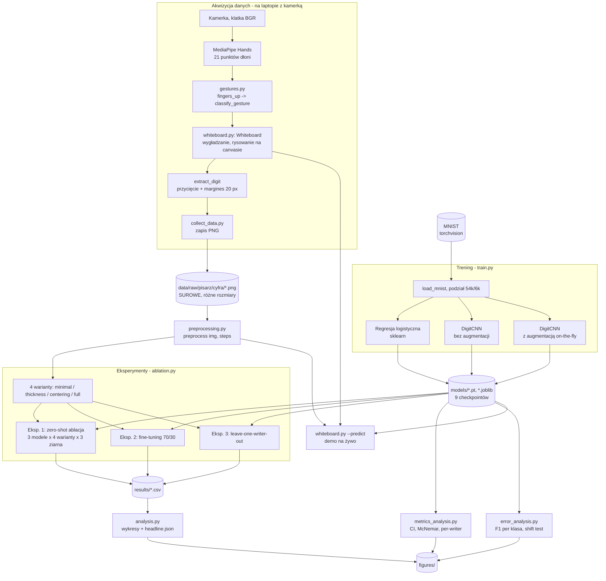
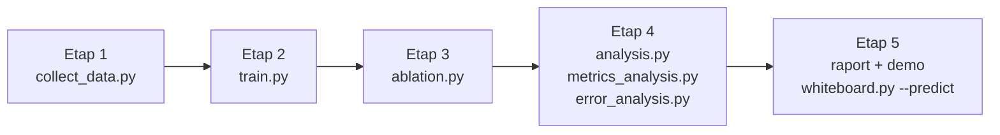

# Przewodnik techniczny po projekcie *Writing in the Air*

Ten dokument ma jeden cel: żeby każda osoba z zespołu rozumiała kod i wyniki
na tyle dobrze, żeby spokojnie odpowiedzieć na pytania po prezentacji.
Czyta się go od góry do dołu, ale sekcja 10 (pytania egzaminatora) działa też
samodzielnie jako ściąga.

Wszystkie liczby poniżej pochodzą z plików w `results/` (oficjalny przebieg
z 7 listopada 2026, ziarna 42/43/44, 807 naszych cyfr). Jeśli liczba jest
podana bez komentarza, to jest średnia z 3 ziaren.

---

## 0. Najważniejsze w 60 sekund

**Pytanie badawcze.** O ile spada dokładność klasyfikatora wytrenowanego na
MNIST, gdy dostaje cyfry pisane palcem w powietrzu, i która interwencja
(normalizacja grubości kreski, centrowanie po środku masy, augmentacja
w treningu, fine-tuning) najlepiej zamyka tę lukę?

**Najważniejsze liczby** (do zapamiętania):

| Co | Wynik | Plik źródłowy |
|---|---|---|
| CNN na teście MNIST | **99,33 %** | `results/mnist_test_runs.csv` |
| Regresja logistyczna na teście MNIST | 92,35 % | j.w. |
| CNN na naszych danych, minimalny preprocessing | **96,53 %** | `results/ablation_summary.csv` |
| Luka domenowa (domain gap) CNN | **2,80 pp** (błędów 5,2× więcej) | `results/metrics/gap_closed.csv` |
| CNN, tylko normalizacja grubości | 97,48 % (zamyka 34 % luki) | j.w. |
| CNN, tylko centrowanie | 98,43 % (zamyka 68 % luki) | j.w. |
| CNN, pełny preprocessing | **99,46 %** (zamyka całą lukę) | j.w. |
| CNN z augmentacją, pełny preprocessing | 97,19 % (**gorzej** niż bez augmentacji) | `results/ablation_summary.csv` |
| Regresja logistyczna: minimal → full | 55,47 % → 79,97 % | j.w. |
| Fine-tuning na 70 % naszych danych | 99,86 % → 100 % (efekt sufitu) | j.w. |

**Trzy wnioski jednym zdaniem każdy:**

1. Luka domenowa istnieje, ale dla CNN jest mała (2,8 pp), a dla modelu
   liniowego ogromna (36,9 pp).
2. Sam preprocessing (grubość + centrowanie), bez żadnych naszych danych
   treningowych, zamyka całą lukę CNN. Centrowanie daje więcej niż grubość.
3. Augmentacja zaszkodziła, a fine-tuning nic nie pokazał, bo model był już
   przy suficie.

---

## 1. Co to za projekt i dlaczego tablica gestów nie jest celem

Projekt to **badanie empiryczne przesunięcia domeny (domain shift)**.
Domena źródłowa to MNIST: zeskanowane cyfry pisane długopisem na papierze.
Domena docelowa to nasze cyfry rysowane palcem przed kamerką internetową.

Tablica sterowana gestami (`whiteboard.py`) to **instrument pomiarowy**:
dzięki niej zebraliśmy własny zbiór danych (807 obrazków, 4 osoby piszące,
20 próbek na cyfrę; jedna osoba ma 207 zamiast 200, bo przy cyfrach 0, 6 i 7
zapisała kilka próbek więcej i zostawiliśmy je bez zmian). Jest też naszym
demo na żywo (`whiteboard.py --predict`). Oceniane jest jednak badanie:
zmierzona luka, ablacja, analiza błędów.

Dlaczego to w ogóle problem? Cyfry pisane w powietrzu różnią się od MNIST:

- kreska ma stałą grubość ustaloną w programie, a po zmniejszeniu do 28×28
  jest **dużo cieńsza** niż w MNIST (mediana 0,90–1,55 px vs 2,44 px),
- nie da się "podnieść długopisu", więc mogą pojawiać się linie łączące,
- ręka drży, proporcje i położenie cyfry są przypadkowe,
- każda osoba ma swój styl (np. jedynka z "daszkiem" w stylu europejskim).

---

## 2. Architektura i przepływ danych

### 2.1 Diagram (mermaid)



### 2.2 To samo w ASCII (gdyby mermaid się nie renderował)

```
 KAMERKA ──> MediaPipe (21 pkt) ──> gestures.py ──> Whiteboard (canvas 0/255)
                                                        │ extract_digit()
                                                        v
                                     collect_data.py ──> data/raw/<pisarz>/<cyfra>/*.png
                                                        │   (surowe, NIE 28x28)
                                                        v
 MNIST ──> train.py ──> models/ (logreg, cnn, aug) x 3 ziarna
                │                       │
                │                       v
                │     preprocessing.preprocess(img, steps) -> 28x28 float32
                │                       │
                │                       v
                └──────────────> ablation.py ──> results/*.csv
                                        │
              ┌─────────────────────────┼──────────────────────────┐
              v                         v                          v
         analysis.py           metrics_analysis.py         error_analysis.py
     (wykresy, headline)     (CI, McNemar, per writer)   (F1, konfuzje, shift)
              └──────────────> figures/, results/ <────────────────┘

 Demo:  kamerka -> Whiteboard -> extract_digit -> preprocess(FULL) -> CNN seed 42
```

### 2.3 Kolejność uruchamiania

```bash
python train.py              # ~1 h na CPU laptopa, 15-25 min na Colab T4
python ablation.py           # eksperymenty na naszych danych
python analysis.py           # wykresy i results/headline.json
python metrics_analysis.py   # tylko inferencja, ~1-2 min
python error_analysis.py     # tylko inferencja, kilka minut
```

Kluczowa zasada projektu: **liczby nie są nigdzie wpisywane ręcznie**.
`analysis.py` tylko czyta CSV-ki z `train.py` i `ablation.py`; raport cytuje
pliki z `results/`.

### 2.4 Kontrakty między modułami

Ustaliliśmy dwa interfejsy, żeby części mogły powstawać równolegle:

```python
# preprocessing.py
def preprocess(img: np.ndarray, steps: list[str]) -> np.ndarray:
    """Surowy rysunek w skali szarości -> 28x28 float32, znormalizowany jak MNIST."""

# model.py
def predict(img: np.ndarray) -> tuple[int, float]:
    """img: 28x28 float32. Zwraca (cyfra, pewność)."""
```

### 2.5 Workflow krok po kroku: co każdy skrypt czyta i co zapisuje

Cały projekt to pięć etapów. Każdy etap zapisuje pliki na dysk, a następny
je czyta, więc etapy można uruchamiać osobno i nic nie trzeba trzymać
w pamięci między nimi.



| Etap | Skrypt | Czyta | Zapisuje | Czas |
|---|---|---|---|---|
| 1. Zbieranie danych | `collect_data.py --writer <imię>` | obraz z kamerki | `data/raw/<pisarz>/<cyfra>/*.png` (surowe, różne rozmiary) | zależy od osoby |
| 2. Trening na MNIST | `train.py` | MNIST (pobierany przez torchvision do `data/mnist/`) | `models/cnn_mnist_seed4X.pt`, `models/cnn_aug_seed4X.pt`, `models/logreg_seed4X.joblib`, `results/history_*.csv`, `results/mnist_test_runs.csv` | ok. 1 h na CPU |
| 3. Eksperymenty | `ablation.py` | `data/raw/`, wszystkie checkpointy z `models/` | `data/labels.csv`, `results/ablation_runs.csv`, `results/ablation_summary.csv`, `results/lowo_*.csv`, `results/per_class_f1.csv`, macierze pomyłek i galerie błędów w `figures/` | kilka minut |
| 4a. Wykresy i liczby główne | `analysis.py` | CSV-ki z etapów 2 i 3, MNIST, `data/raw/` (do statystyk domeny) | `figures/*.png/.pdf`, `results/domain_stats.csv`, `results/headline.json` | ok. 1 min |
| 4b. Statystyka | `metrics_analysis.py` | checkpointy, `data/raw/`, `results/domain_stats.csv`, `results/mnist_test_runs.csv`, `results/ablation_runs.csv`, `results/lowo_runs.csv` | `results/metrics/*.csv` (m.in. `predictions.csv`), `figures/metrics/` | 1–2 min |
| 4c. Analiza błędów | `error_analysis.py` | `results/metrics/predictions.csv`, checkpointy, MNIST, `data/raw/` | `results/analysis/*.csv`, `figures/analysis/` | kilka minut |
| 5. Demo | `whiteboard.py --predict` | kamerka, `models/cnn_mnist_seed42.pt` | nic (tylko okno na ekranie) | na żywo |

Dwie rzeczy, które warto umieć powiedzieć:

- **Etapy 3 i 4 nie trenują od zera** (poza krótkim fine-tuningiem
  w `ablation.py`). Ładują gotowe checkpointy, więc po zmianie preprocessingu
  wystarczy powtórzyć etap 3 i 4, bez ponownego treningu.
- **Kolejność w etapie 4 ma znaczenie:** `analysis.py` tworzy
  `domain_stats.csv`, którego potrzebuje `metrics_analysis.py`, a
  `metrics_analysis.py` musi być przed `error_analysis.py`, bo ten drugi
  czyta `results/metrics/predictions.csv` (jeden wiersz na każdy obrazek ×
  model × wariant × ziarno).

Etapy 2–4 można też uruchomić naraz na Colabie (`airwrite_colab.ipynb`).
Do sprawdzenia, czy wszystko działa, bez czekania godziny, służą flagi
`--quick` (mały trening, wyniki w `*/smoke/`) i `--synthetic` (sztuczne dane,
wyniki w `*/synthetic/`).

### 2.6 Kto kogo importuje

`config.py` importują prawie wszystkie pliki, więc pomijam go w tabeli.

| Plik | Importuje z projektu |
|---|---|
| `gestures.py` | tylko stałe z `config` |
| `whiteboard.py` | `gestures`; w trybie `--predict` także `model` i `preprocessing` |
| `collect_data.py` | `gestures`, `whiteboard` |
| `preprocessing.py` | tylko `config` |
| `model.py` | tylko `config` |
| `data_utils.py` | `preprocessing` (szkielet i deformacja do danych syntetycznych) |
| `evaluate.py` | `model`, `plotting` |
| `train.py` | `data_utils`, `evaluate`, `model`, `preprocessing` (augmentacja) |
| `ablation.py` | `train` (fine-tuning, ziarna), `data_utils`, `evaluate`, `model`, `preprocessing`, `plotting` |
| `analysis.py` | `data_utils`, `preprocessing`, `plotting` |
| `metrics_analysis.py` | `ablation` (lista wariantów), `data_utils`, `evaluate`, `model`, `preprocessing`, `plotting` |
| `error_analysis.py` | `data_utils`, `model`, `preprocessing`, `plotting` |

Warstwy, od dołu:

1. **Fundament:** `config.py` (stałe), `plotting.py` (styl wykresów).
2. **Biblioteka:** `preprocessing.py`, `model.py`, `data_utils.py`,
   `evaluate.py`, `gestures.py`. Nic nie uruchamiają same, tylko dostarczają
   funkcje.
3. **Skrypty:** `train.py`, `ablation.py`, `analysis.py`,
   `metrics_analysis.py`, `error_analysis.py`, `collect_data.py`,
   `whiteboard.py`. Każdy ma `main()` i parametry z linii poleceń.

Warto zauważyć: `whiteboard.py` importuje `model` i `preprocessing` dopiero
w `LivePredictor`, czyli tylko w trybie `--predict`. Dzięki temu samo
rysowanie i zbieranie danych działa bez instalowania PyTorcha.

### 2.7 Droga jednej cyfry, od palca do wyniku

Co dokładnie dzieje się z jedną narysowaną "7":

1. **Kamerka** daje klatkę (prosimy o 960×540, BGR). Obraz jest odbijany lustrzanie.
2. **MediaPipe** zwraca 21 punktów dłoni (x, y w zakresie 0–1).
3. **`gestures.fingers_up`** daje np. `[0, 1, 0, 0, 0]`,
   **`classify_gesture`** zamienia to na `draw`.
4. **`Whiteboard.update`** bierze czubek palca wskazującego, uśrednia
   z 5 ostatnich klatek i rysuje odcinek grubości 12 px na czarnym canvasie.
5. Pięść kończy rysowanie. **`extract_digit`** wycina prostokąt wokół kreski
   z marginesem 20 px, np. 180×260 px.
6. **`collect_data.py`** zapisuje go jako `data/raw/mateusz/7/mateusz_7_012.png`.
   Nic nie jest jeszcze skalowane.
7. **`preprocess(img, FULL_STEPS)`**:
   binaryzacja Otsu → grubość kreski ustawiona na 12 % dłuższego boku cyfry →
   dłuższy bok przeskalowany do 20 px i wklejony w 28×28 → środek masy
   przesunięty na środek → normalizacja (x − 0,1307) / 0,3081.
   Wynik: tablica float32 28×28.
8. **`DigitCNN`**: 1×28×28 → 32×14×14 → 64×7×7 → 128×3×3 → 1152 → 10 logitów.
9. **Softmax** daje 10 prawdopodobieństw; argmax to predykcja, np. "7"
   z pewnością 0,99.
10. W eksperymentach predykcja trafia do `compute_metrics` i wiersza CSV;
    w demo jest rysowana na ekranie razem z obrazkiem 28×28 z kroku 7.

---

## 3. Pliki po kolei

### 3.1 `config.py` – wspólne stałe

Jedno miejsce na wszystkie liczby, które mogłyby się rozjechać między
plikami: ziarna, ścieżki, rozmiary obrazków, hiperparametry treningu,
ustawienia kamerki, numery punktów MediaPipe.

Najważniejsze wartości:

```python
SEED = 42
SEEDS = (42, 43, 44)          # każdy eksperyment 3x, raportujemy mean ± std
IMG_SIZE = 28
DIGIT_BOX = 20                # MNIST: cyfra wpisana w pudełko 20x20, potem 28x28
MNIST_MEAN, MNIST_STD = 0.1307, 0.3081
EPOCHS, BATCH_SIZE, LEARNING_RATE = 8, 128, 1e-3
VAL_SIZE = 6000               # 54k trening / 6k walidacja
FINETUNE_FRACTION, FINETUNE_EPOCHS, FINETUNE_LR = 0.7, 15, 1e-4
STROKE_THICKNESS = 12         # grubość kreski na canvasie (px kamerki)
SMOOTHING_WINDOW = 5          # średnia z 5 ostatnich pozycji palca
CROP_MARGIN = 20              # margines przy wycinaniu cyfry
```

`redirect_outputs(subdir)` przekierowuje wyniki do podfolderu (`smoke/`,
`synthetic/`). Działa, bo inne moduły odczytują `config.RESULTS_DIR` itd.
**w momencie wywołania**, a nie przy imporcie. Dzięki temu testy `--quick`
i `--synthetic` nigdy nie nadpisują prawdziwych wyników.

### 3.2 `gestures.py` – logika gestów (bez kamery)

Celowo **nie importuje MediaPipe ani OpenCV**, pracuje na liście 21 punktów
`(x, y)`. Dlatego da się ją przetestować bez kamerki: `python gestures.py`
uruchamia autotest na sztucznych dłoniach (6 przypadków, wszystkie przechodzą).

Dwie funkcje:

```python
def fingers_up(landmarks):
    # kciuk: czy czubek jest dalej od nasady małego palca niż staw IP
    tip_far = _distance(landmarks[THUMB_TIP], landmarks[PINKY_MCP])
    ip_far  = _distance(landmarks[THUMB_IP],  landmarks[PINKY_MCP])
    state.append(1 if tip_far > ip_far else 0)
    # pozostałe palce: czy czubek jest wyżej (mniejsze y) niż staw PIP
    for tip, pip in ((INDEX_TIP, INDEX_PIP), ...):
        state.append(1 if landmarks[tip][1] < landmarks[pip][1] else 0)
```

Dlaczego kciuk inaczej? Kciuk porusza się na boki, nie w górę. Porównanie
odległości od nasady małego palca działa tak samo dla lewej i prawej ręki
(obraz jest odbity lustrzanie).

```python
def classify_gesture(state):
    _, index, middle, ring, pinky = state       # kciuk ignorowany
    if index and not middle and not ring and not pinky:  return MODE_DRAW   # wskazujący
    if index and middle and not ring and not pinky:      return MODE_MOVE   # dwa palce
    if not index and not middle and not ring and not pinky: return MODE_PAUSE  # pięść
    if index and middle and ring and pinky:              return MODE_CLEAR  # otwarta dłoń
    return MODE_NONE
```

Kciuk jest ignorowany przy rysowaniu, bo większość ludzi przy wskazywaniu
nie chowa kciuka.

### 3.3 `whiteboard.py` – śledzenie dłoni i canvas

Trzy klasy:

- **`HandTracker`** opakowuje MediaPipe Hands (jedna dłoń, progi pewności
  0,7 / 0,6). Konwertuje klatkę BGR (OpenCV) na RGB (MediaPipe) i zwraca 21
  punktów w zakresie [0, 1].
- **`Whiteboard`** trzyma canvas: obraz **w skali szarości, biała kreska na
  czarnym tle**, czyli od razu w konwencji MNIST (nie trzeba odwracać kolorów).
- **`LivePredictor`** do demo: ładuje `cnn_mnist_seed42.pt` i używa
  **dokładnie tego samego** `preprocess(..., FULL_STEPS)` co w eksperymentach.

Serce rysowania, `Whiteboard.update()`:

```python
if landmarks is None:          # dłoń zniknęła
    self._end_stroke()         # inaczej powstałaby linia do miejsca, gdzie dłoń wróci
    ...
self.mode = classify_gesture(fingers_up(landmarks))
nx, ny = landmarks[config.INDEX_TIP]                 # czubek palca wskazującego
raw = (int(nx * self.width), int(ny * self.height))
...
cursor = self._smooth(raw)                           # średnia z 5 ostatnich pozycji
if self._prev_point is not None:
    cv2.line(self.canvas, self._prev_point, cursor, color=255,
             thickness=config.STROKE_THICKNESS, lineType=cv2.LINE_AA)
```

- **Wygładzanie** (średnia krocząca z 5 pozycji, `deque(maxlen=5)`): MediaPipe
  lekko "skacze" między klatkami, uśrednianie daje gładsze linie kosztem
  minimalnego opóźnienia.
- **Rysujemy odcinki między kolejnymi punktami**, a nie pojedyncze kropki,
  dzięki temu kreska jest ciągła nawet przy szybkim ruchu.
- **`LINE_AA`** (antyaliasing) daje szare krawędzie, dlatego w preprocessingu
  jest krok binaryzacji.

`extract_digit()` wycina prostokąt otaczający kreskę + 20 px marginesu
i **celowo nie skaluje do 28×28**. Surowy rysunek jest zapisywany, żeby
wszystkie warianty preprocessingu startowały z tego samego obrazka. Gdybyśmy
skalowali przy zbieraniu, ablacja byłaby bez sensu.

Demo (`--predict`): predykcja odpala się raz, gdy ręka przestaje rysować
(pięść, dwa palce albo dłoń poza kadrem), flaga `dirty` pilnuje, żeby nie
liczyć w każdej klatce. Klawisz `p` przełącza full/minimal na tym samym
rysunku, co pozwala pokazać efekt preprocessingu na żywo. W rogu widać
obrazek 28×28, który faktycznie dostaje model.

### 3.4 `collect_data.py` – zbieranie danych

Używa `HandTracker` i `Whiteboard`. Przechodzi przez cyfry 0–9, SPACJA
zapisuje rysunek jako PNG:

```
data/raw/<pisarz>/<cyfra>/<pisarz>_<cyfra>_<nnn>.png
```

Numeracja jest kontynuowana (`count_existing() + 1`), więc można przerwać
i wrócić bez nadpisywania. Zielona ramka oznacza, że dla tej cyfry jest już
wystarczająco próbek. Instrukcja dla piszących: **pisz normalnie, nie udawaj
MNIST**, bo chcemy zmierzyć prawdziwą różnicę.

### 3.5 `data_utils.py` – wczytywanie danych

- `load_mnist(train)` – MNIST z torchvision jako tablice numpy uint8.
- `scan_raw_folder()` – lista `(ścieżka, etykieta, pisarz)`, **posortowana**,
  żeby późniejsze podziały były powtarzalne. Etykieta i pisarz wynikają
  z nazwy folderu.
- `load_airwrite()` – wczytuje surowe PNG (różne rozmiary!) i regeneruje
  `data/labels.csv`.
- `make_synthetic_airwrite()` – **sztuczne** "cyfry z powietrza" zrobione
  z testu MNIST (szkielet → pochylenie → gruba kreska → linie łączące →
  drżenie elastyczne). Służyło tylko do testowania pipeline'u, zanim mieliśmy
  prawdziwe dane. **Te liczby nigdy nie trafiają do raportu.**

### 3.6 `preprocessing.py` – serce badania

Każdy krok można włączyć lub wyłączyć osobno, bo ablacja mierzy je po kolei.
Kroki zawsze wykonują się w tej kolejności, niezależnie od kolejności na
liście:

```python
ALL_STEPS = [
    "binarize",             # próg Otsu
    "normalize_thickness",  # grubość kreski względem rozmiaru cyfry
    "resize_padded",        # wpasowanie w 20x20 z zachowaniem proporcji, dopełnienie do 28x28
    "center_by_mass",       # środek masy na środek obrazka
    "normalize_pixels",     # średnia/odchylenie MNIST
]
MINIMAL_STEPS = ["resize_padded", "normalize_pixels"]
FULL_STEPS = list(ALL_STEPS)
TARGET_STROKE_RATIO = 0.12
```

Opis kroków:

**`binarize`** – próg Otsu (`cv2.THRESH_OTSU`) sam dobiera próg, który
najlepiej rozdziela dwa poziomy jasności. Usuwa szare krawędzie po
antyaliasingu, żeby operacje morfologiczne działały na czystej masce.

**`normalize_thickness`** – najciekawszy krok. Najpierw mierzymy grubość
kreski:

```python
def estimate_stroke_width(img):
    dist = cv2.distanceTransform(binary, cv2.DIST_L2, 5)   # odległość do tła
    centre = skeletonize(binary) > 0                       # linia środkowa
    return float(2 * np.median(dist[centre]))
```

Na szkielecie (linia środkowa kreski) transformata odległości to połowa
lokalnej grubości, więc grubość = 2 × mediana. Potem porównujemy ją z celem
`0.12 × dłuższy bok cyfry` i **erodujemy** (pocieniamy) albo **dylatujemy** (pogrubiamy) dyskiem o rozmiarze różnicy.
Jeśli erozja zjadłaby ponad 75 % tuszu (cienkie fragmenty mogłyby zniknąć),
kernel jest zmniejszany.

Dlaczego 0,12? Po przeskalowaniu dłuższego boku do 20 px daje to
0,12 × 20 = 2,4 px, a mediana grubości w MNIST to 2,44 px. Wartość ustaliliśmy
**przed** zebraniem danych. `metrics_analysis.py` sprawdza 0,06–0,18 tylko
jako test odporności (98,5–99,5 % średnio), wyboru wartości na tej podstawie
nie robiliśmy, bo byłoby to strojenie na zbiorze testowym.

Dlaczego erozja/dylatacja oryginału, a nie przerysowanie szkieletu grubszym
pędzlem? Szkielet ma małe "ostrogi", które po pogrubieniu zamieniają się
w kleksy.

Dlaczego ten krok jest **przed** skalowaniem? Morfologia na obrazku w pełnej
rozdzielczości jest dokładna; na 28×28 mamy tylko kilka możliwych grubości.

**`resize_padded`** – wycina cyfrę, skaluje **dłuższy bok do 20 px
z zachowaniem proporcji** (`INTER_AREA` daje miękkie krawędzie jak w MNIST),
wkleja na środek czarnego obrazka 28×28. Bez zachowania proporcji jedynka
rozciągnęłaby się w prostokąt. To dokładnie procedura, którą stworzono
MNIST (LeCun i in., 1998).

**`center_by_mass`** – liczy środek masy jasności i przesuwa obraz tak, żeby
wypadł w środku (13,5; 13,5). Też jak w oryginalnym MNIST:

```python
cy = (ys * img).sum() / total
cx = (xs * img).sum() / total
shift = np.float32([[1, 0, centre - cx], [0, 1, centre - cy]])
return cv2.warpAffine(img, shift, ...)
```

Uwaga: `resize_padded` centruje *prostokąt otaczający*, a `center_by_mass`
centruje *masę tuszu*. Dla cyfry jak 7 (dużo tuszu u góry) to dwie różne
rzeczy.

**`normalize_pixels`** – skala [0, 1], potem `(x − 0,1307) / 0,3081`.
Sieć była trenowana na tak znormalizowanych danych, więc ten krok jest
w każdym wariancie, także w "minimal".

**`augment()`** (tylko w treningu, na obrazkach MNIST 28×28 uint8):

| Transformacja | Parametry | Co symuluje |
|---|---|---|
| dylatacja | 50 % szans, kernel 2×2 lub 3×3 | grubsza kreska |
| rotacja | ±10° | przechylona ręka |
| skala | 0,9–1,1 | różny rozmiar |
| przesunięcie | ±2 px | niedokładne położenie |
| deformacja elastyczna | 50 % szans, α = 34, σ = 4 (Simard i in., 2003) | drżenie ręki |

### 3.7 `model.py` – sieć CNN

```python
def _block(c_in, c_out):
    return nn.Sequential(
        nn.Conv2d(c_in, c_out, kernel_size=3, padding=1, bias=False),
        nn.BatchNorm2d(c_out),
        nn.ReLU(inplace=True),
        nn.MaxPool2d(2),
    )

class DigitCNN(nn.Module):
    def __init__(self, dropout=0.3):
        self.features = nn.Sequential(_block(1, 32), _block(32, 64), _block(64, 128))
        self.classifier = nn.Sequential(nn.Flatten(), nn.Dropout(dropout),
                                        nn.Linear(128 * 3 * 3, 10))
```

Kształty tensorów i liczba parametrów:

| Warstwa | Wyjście | Parametry |
|---|---|---|
| wejście | 1 × 28 × 28 | – |
| blok 1 (conv 3×3, 32 filtry, BN, ReLU, maxpool) | 32 × 14 × 14 | 288 + 64 |
| blok 2 (64 filtry) | 64 × 7 × 7 | 18 432 + 128 |
| blok 3 (128 filtrów) | 128 × 3 × 3 | 73 728 + 256 |
| flatten + dropout 0,3 | 1152 | – |
| linear | 10 (logity) | 11 530 |
| **razem** | | **104 426** (~104 tys.) |

Uwagi:
- `bias=False` w konwolucjach, bo BatchNorm i tak ma własne przesunięcie (β),
  bias byłby nadmiarowy.
- 7 → 3 przy trzecim poolingu (zaokrąglenie w dół).
- Wyjście to **logity**; softmax jest liczony dopiero w `predict_batch`,
  bo `CrossEntropyLoss` sam robi log-softmax.
- `forward` dodaje wymiar kanału, jeśli wejście ma kształt (N, 28, 28).

Pozostałe funkcje: `checkpoint_path`, `save_model`, `load_model` (zapisujemy
tylko `state_dict`, ładowanie z `weights_only=True`, czyli bezpiecznie),
`predict_batch` (inferencja w paczkach po 512, `@torch.no_grad()`),
`predict` (kontrakt z CLAUDE.md, model ładowany leniwie przy pierwszym
wywołaniu i trzymany w cache).

### 3.8 `train.py` – trening na MNIST

Trenuje trzy modele dla każdego z trzech ziaren:

1. **Regresja logistyczna** (scikit-learn, `max_iter=200`) na 784 surowych,
   znormalizowanych pikselach. Baseline: model liniowy bez żadnej wiedzy
   o strukturze obrazu.
2. **CNN** bez augmentacji (`cnn_mnist_seed*.pt`).
3. **CNN z augmentacją** (`cnn_aug_seed*.pt`).

Kluczowe elementy:

```python
def set_seed(seed):
    random.seed(seed); np.random.seed(seed); torch.manual_seed(seed)
    torch.cuda.manual_seed_all(seed)
    torch.backends.cudnn.deterministic = True
    torch.backends.cudnn.benchmark = False
```

- `split_train_val` – losowy podział 54 000 / 6 000 zależny od ziarna. Test
  MNIST (10 000) nie jest używany do żadnych decyzji, tylko do raportu.
- `DigitDataset` – augmentacja **w locie** (`__getitem__`), na uint8 przed
  normalizacją, więc każda epoka widzi inne zniekształcenia. Jeden generator
  losowy na cały zbiór; przy `num_workers=0` to jest powtarzalne.
- `DataLoader(..., shuffle=True, generator=torch.Generator().manual_seed(seed))`
  – kolejność batchy też zależy od ziarna.
- `fit()` – **Adam**, lr = 1e-3, **cosine annealing** przez 8 epok,
  `CrossEntropyLoss`. Zapisuje historię (strata i dokładność na treningu
  i walidacji, czas epoki) do `results/history_*.csv`.
- `fine_tune()` – dotrenowanie na naszych danych: lr = 1e-4 (10× mniejszy),
  15 epok, batch 32. Mamy kilkaset obrazków, więc chcemy model *dostroić*,
  a nie wytrenować od nowa (i nie zapomnieć MNIST).
- `upsert_rows()` – dopisuje wiersze do CSV, zastępując stare o tym samym
  kluczu. Można powtórzyć jeden model/ziarno bez kasowania reszty.

Zmierzone czasy (CPU): ~32 s na epokę CNN, ~38 s z augmentacją, ~4,4 min na
cały trening CNN, ~50 s regresja logistyczna. Końcowa dokładność walidacji
CNN: 99,22–99,55 %; CNN z augmentacją: 98,90–99,17 %. Dokładność treningowa
przy augmentacji jest niższa (97,1 % vs 99,8 %), co jest normalne: trudniejsze
dane treningowe, a walidacja jest bez augmentacji.

### 3.9 `evaluate.py` – metryki i statystyka

- `compute_metrics` – accuracy, macro-F1 i F1 dla każdej cyfry (sklearn).
- `summarise` – z wierszy per ziarno robi `mean` i `std` per konfiguracja.
- `save_confusion_matrix` – macierz pomyłek do `figures/`.
- `bootstrap_accuracy_ci` – przedział ufności 95 % metodą bootstrap
  (2000 losowań ze zwracaniem obrazków; przy kilku ziarnach te same obrazki
  dla wszystkich ziaren).
- `mcnemar_test` – dokładny test McNemara: dwa modele na tych samych
  obrazkach; liczymy tylko obrazki, na których się różnią
  (b = A dobrze/B źle, c = A źle/B dobrze); jeśli modele są równie dobre,
  b ~ Binomial(b + c, 0,5).
- `gap_closed` – jaka część luki została zamknięta:
  `(acc_wariant − acc_minimal) / (acc_MNIST − acc_minimal)`;
  0 = bez poprawy, 1 = jak na MNIST, > 1 = lepiej niż na MNIST.
- `rule_of_three_upper` – górna granica 95 % na odsetek błędów; przy 0 błędach
  "reguła trzech" 3/n, w przeciwnym razie granica Wilsona.

### 3.10 `ablation.py` – wszystkie eksperymenty na naszych danych

```python
VARIANTS = {
    "minimal":   ["resize_padded", "normalize_pixels"],
    "thickness": ["binarize", "normalize_thickness", "resize_padded", "normalize_pixels"],
    "centering": ["resize_padded", "center_by_mass", "normalize_pixels"],
    "full":      ["binarize", "normalize_thickness", "resize_padded",
                  "center_by_mass", "normalize_pixels"],
}
```

Trzy eksperymenty:

1. **Zero-shot** (`zero_shot`): 3 modele × 4 warianty × 3 ziarna = 36 przebiegów
   na wszystkich 807 obrazkach. **Bez dotrenowania**, zmienia się tylko
   preprocessing w czasie testu. Dlatego te same checkpointy wystarczą.
2. **Fine-tuning** (`finetune_split`): stratyfikowany podział 70/30
   (`train_test_split(..., stratify=labels, random_state=seed)`), test na 30 %
   (243 obrazki) przed i po dotrenowaniu na 70 %. Wariant `full`.
3. **Leave-one-writer-out** (`leave_one_writer_out`): dotrenowanie na 3
   pisarzach, test na czwartym, dla każdego pisarza i ziarna.

Zapisuje `ablation_runs.csv`, `ablation_summary.csv`, `lowo_*.csv`,
`per_class_f1.csv`, macierze pomyłek i galerie błędnie sklasyfikowanych
cyfr. Flaga `--synthetic` drukuje wielki napis ostrzegawczy i zapisuje do
`results/synthetic/`.

### 3.11 `analysis.py` – wykresy i headline

Nic nie liczy od nowa z modeli; czyta CSV-ki. Rysuje krzywe uczenia,
przykłady cyfr per pisarz, kolejne kroki preprocessingu, przykłady
augmentacji, rozkłady grubości kreski i wypełnienia (MNIST vs my),
wykresy ablacji i LOWO. Zapisuje `results/domain_stats.csv`
i `results/headline.json`.

Statystyki domeny:
- `stroke_width` – grubość kreski liczona na obrazku powiększonym 4× (na 28×28
  jest za mało możliwych wartości), potem dzielona przez 4.
- `fill_ratio` – odsetek pikseli z tuszem (> 0,5).

### 3.12 `metrics_analysis.py` – statystyka wyników

Rozbudowana ewaluacja zero-shot: przedziały ufności, McNemar dla 8 par
porównań z poprawką **Holma-Bonferroniego** (8 testów na ziarno), wyniki per
pisarz, najczęstsze pomyłki, pewność modelu przy błędach, czułość na
`TARGET_STROKE_RATIO`, sprawdzenie efektu sufitu, grubość kreski po
augmentacji. Tylko inferencja na zapisanych checkpointach, ~1–2 min.
Wyjście w `results/metrics/` i `figures/metrics/`.

### 3.13 `error_analysis.py` – analiza błędów

F1 per cyfra dla każdego modelu i wariantu, jak zmieniają się pomyłki od
minimal do full, galeria głównych pomyłek (surowy rysunek / wejście minimal /
wejście full), które osoby mają jedynki czytane jako siódemki, oraz
**test przesunięcia na MNIST**: przesuwa cyfry testowe o k pikseli
(średnia z 4 kierunków) i porównuje CNN z regresją logistyczną. To jest
eksperyment, który wyjaśnia, dlaczego centrowanie pomaga modelowi liniowemu
dużo bardziej.

### 3.14 `plotting.py`, `figs.py`, `derive.py`

- `plotting.py` – wspólny styl wykresów (paleta przyjazna dla daltonistów,
  każdy pisarz zawsze ma ten sam kolor), zapis PNG + PDF, funkcje do macierzy
  pomyłek, słupków z błędami, histogramów, siatek cyfr i galerii.
- `figs.py` – dodatkowe wykresy do raportu (schemat pipeline'u, przybliżone
  osie, wykres per pisarz, czułość). Wejście: folder z CSV-kami.
- `derive.py` – dodatkowe liczby do raportu, które nie są wprost w CSV
  (np. ile obrazków poprawił krok grubości u każdej osoby). Zapisuje
  `derived.json`.

### 3.15 `airwrite_colab.ipynb`

Notebook, który na Colabie klonuje repo, sprawdza GPU, uruchamia
`train.py → ablation.py → analysis.py` i pakuje `results/`, `figures/`,
`models/` do zipa. Oficjalny przebieg i tak zrobiliśmy na CPU, bo czas był
akceptowalny.

---

## 4. Model i trening: decyzje i uzasadnienia

| Decyzja | Uzasadnienie |
|---|---|
| Mała CNN (~104 tys. parametrów), 3 bloki conv | Projekt jest o danych, nie o architekturze. MNIST nie wymaga większej sieci (99,3 %). Trzeba trenować 6 razy (2 warianty × 3 ziarna). |
| Konwolucje 3×3 + max-pooling | Lokalne wzorce (krawędzie, zakręty) + częściowa niezmienniczość na przesunięcie. To dokładnie to, czego brakuje regresji logistycznej. |
| BatchNorm | Stabilniejszy i szybszy trening, mniejsza wrażliwość na lr. |
| Dropout 0,3 przed warstwą liniową | Regularyzacja, mniej przeuczenia. |
| Adam, lr 1e-3 | Standardowy, działa bez strojenia. |
| Cosine annealing przez 8 epok | Płynne zmniejszanie lr, lepsza końcówka treningu bez ręcznego harmonogramu. |
| 8 epok | Krzywe walidacji spłaszczają się wcześniej, a każda epoka to ~32 s na CPU. |
| Walidacja 6k z treningu MNIST | Test MNIST zostaje nietknięty do raportu. |
| Regresja logistyczna jako baseline | Model liniowy, piksel po pikselu. Pokazuje, jak bardzo architektura wpływa na odporność na przesunięcie domeny. |
| Fine-tuning lr 1e-4, 15 epok | Mało danych, chcemy dostroić, a nie przetrenować. |
| 3 ziarna, mean ± std | Odchylenie pokazuje szum treningu; wymóg z CLAUDE.md. |

---

## 5. Eksperymenty i co oznaczają wyniki

### 5.1 Pełna tabela ablacji zero-shot (807 obrazków)

| Model | Minimal | Thickness | Centering | Full |
|---|---|---|---|---|
| Regresja logistyczna | 55,47 % | 63,28 % | 74,56 % | 79,97 % |
| CNN | 96,53 % | 97,48 % | 98,43 % | **99,46 %** |
| CNN z augmentacją | 94,34 % | 94,96 % | 97,56 % | 97,19 % |

Dla porównania na teście MNIST: logreg 92,35 %, CNN 99,33 %, CNN z augmentacją
99,12 %.

Przedziały ufności 95 % (bootstrap) dla CNN: minimal 95,5–97,5 %,
full 99,0–99,8 %. Błędów na ziarno: 28 → 20,3 → 12,7 → 4,3.

### 5.2 Jak czytać ablację

- **Centrowanie > grubość.** Dla CNN centrowanie zamyka 68 % luki, grubość
  34 %, razem 105 % (czyli wynik minimalnie lepszy niż na MNIST, ale w granicach
  przedziału ufności, więc mówimy "zamyka całą lukę", nie "lepiej niż MNIST").
- **Istotność (McNemar z Holmem):** minimal → centering i minimal → full są
  istotne dla wszystkich 3 ziaren. Minimal → thickness **nie** jest istotne
  dla żadnego ziarna, więc sam krok grubości to trend, a nie udowodniony
  efekt przy tej liczbie danych. Uczciwie to mówimy.
- **Dlaczego model liniowy cierpi bardziej?** Regresja logistyczna ma jedną
  wagę na piksel. Cyfra przesunięta o 2 piksele trafia na wagi nauczone dla
  innych cyfr. Sprawdziliśmy to bezpośrednio na MNIST:

| Przesunięcie (px) | 0 | 1 | 2 | 3 | 4 |
|---|---|---|---|---|---|
| CNN | 99,33 % | 99,20 % | 98,22 % | 94,97 % | 85,48 % |
| Regresja logistyczna | 92,35 % | 86,19 % | 62,44 % | 35,00 % | 18,56 % |

  2 px kosztuje CNN ~1 pp, a model liniowy ~30 pp. CNN też nie jest w pełni
  odporna (przy 3–4 px spada), dlatego centrowanie jej również pomaga.

### 5.3 Statystyki domeny – co dokładnie się różni

| | MNIST | Nasi pisarze |
|---|---|---|
| mediana grubości kreski (px przy 28×28) | 2,44 | 0,90–1,55 |
| mediana wypełnienia (odsetek tuszu) | 0,130 | 0,052–0,081 |

Osoba z najcieńszą kreską (roman, 0,90 px) jest najtrudniejsza przy minimal:
CNN 92,9 % vs 97,2–98,3 % u pozostałych. Po full preprocessingu: 99,2 %,
tyle co inni (99,0–99,8 %). Krok, który celuje w zmierzoną różnicę, zamyka
lukę u osoby, u której ta różnica jest największa.

### 5.4 Najczęstsze pomyłki CNN (błędy na ziarno)

| Prawda → predykcja | Minimal | Full | Interpretacja |
|---|---|---|---|
| 6 → 5 | 6,33 | 0,33 | długa górna kreska, mała pętla nisko |
| 7 → 1 | 6,00 | 0 | wąska 7 z krótką poprzeczką |
| 1 → 7 | 3,67 | 1,67 | jedynka z "daszkiem" (styl europejski) |
| 9 → 3 | 3,67 | 0,33 | otwarta pętla dziewiątki |

1 → 7 przetrwa preprocessing, bo wynika ze **stylu pisania**, a nie z grubości
czy położenia. Tego żaden krok normalizacji nie naprawi.

### 5.5 Dlaczego augmentacja zaszkodziła (hipoteza)

CNN z augmentacją jest gorsza na naszych danych przy każdym wariancie
(97,19 % vs 99,46 % przy full, McNemar istotny dla wszystkich ziaren), chociaż
na MNIST jest prawie tak samo dobra (99,12 % vs 99,33 %). Prawie cała różnica
to jedna pomyłka: **jedynki czytane jako siódemki** (18 błędów na ziarno przy
full; F1 dla cyfry 1: 0,84 vs 0,985). Skupia się u osób z najdłuższym
"daszkiem" jedynki (45 % jedynek kirilla, 27 % mateusza, 5 % kacpra).

Dwa zmierzone fakty wskazują przyczynę, ale **to jest hipoteza, nie wynik**:

1. Augmentacja pogrubia kreski treningowe (mediana 2,44 → 3,24 px), a nasze
   kreski są cieńsze niż MNIST. Augmentacja odsunęła dane treningowe od
   naszych właśnie w tym wymiarze, w którym różnica jest największa.
2. Rotacja i deformacja elastyczna zamieniają niektóre siódemki MNIST
   w prawie pionowe kreski z krótką ukośną górą, czyli coś bardzo podobnego
   do naszej jedynki z daszkiem.

Eksperymentu potwierdzającego (trening z każdą augmentacją osobno) nie
zrobiliśmy. Ogólna lekcja: augmentacja musi naśladować prawdziwą domenę
docelową; nasza tablica daje czyste, równe kreski, a augmentacja była
zaprojektowana pod zaszumione dane.

### 5.6 Fine-tuning i LOWO: efekt sufitu

- **Fine-tuning:** CNN na 243 obrazkach testowych ma 0, 1 i 0 błędów *przed*
  dotrenowaniem i 0 *po*. Przy 0 błędach na 243 obrazkach górna granica 95 %
  na odsetek błędów to nadal 1,2 % (reguła trzech). "100 %" znaczy więc
  "brak mierzalnej różnicy", a nie "fine-tuning rozwiązał problem".
- **LOWO:** przed dotrenowaniem 99,0–99,8 % na każdej odłożonej osobie
  (0–2 błędy na 200), po 99,4–100 %.

Oba eksperymenty zaczynają od modelu, który z pełnym preprocessingiem jest już
przy suficie, więc nie mogą rozróżnić interwencji. Bardziej informatywna
wersja (LOWO przy minimal, gdzie luka zostaje) nie była uruchomiona.

### 5.7 Pewność modelu

Błędne odpowiedzi CNN mają niższą pewność niż poprawne (0,68 vs 0,96 przy
minimal), ale 17 % błędów przy minimal ma pewność ≥ 0,9. Próg pewności
wyłapałby większość błędów, ale nie wszystkie. Ważne dla demo: pewna
odpowiedź nie zawsze jest poprawna.

---

## 6. Odtwarzalność

- **Ziarna:** `config.SEEDS = (42, 43, 44)`, ustawiane w `set_seed()` dla
  `random`, NumPy i PyTorch; cuDNN w trybie deterministycznym; generator
  DataLoadera i generator augmentacji z ziarnem; `num_workers=0`.
- **Podziały:** `scan_raw_folder()` sortuje pliki, `train_test_split`
  dostaje `random_state=seed`, podział MNIST też zależy od ziarna.
- **Wersje bibliotek:** przypięte w `requirements.txt` dla Pythona 3.11
  (m.in. `torch==2.5.1`, `numpy==1.26.4`, `scikit-learn==1.5.2`,
  `mediapipe==0.10.21`, `opencv-contrib-python==4.10.0.84`). MediaPipe
  0.10.21 nie ma kół dla Pythona 3.13+, a nowsze wersje usunęły API
  `mp.solutions`, którego używamy, dlatego wersja jest przypięta celowo.
- **Checkpointy:** wszystkie 9 (3 modele × 3 ziarna) są w repo w `models/`,
  więc `metrics_analysis.py` i `error_analysis.py` odtwarzają wyniki bez
  ponownego treningu.
- **Brak ręcznych liczb:** każda liczba w raporcie pochodzi z pliku
  w `results/`, wygenerowanego przez kod w repo. Wyniki syntetyczne i `--quick`
  trafiają do osobnych folderów, które są w `.gitignore`.
- **Dane:** surowe rysunki są w repo (`data/raw/`), `data/labels.csv` jest
  generowany automatycznie.

Zastrzeżenie, gdyby ktoś zapytał: pełna bitowa powtarzalność jest
gwarantowana tylko na tym samym sprzęcie i tych samych wersjach (CPU vs GPU
mogą się różnić w ostatnich miejscach po przecinku). Oficjalny przebieg był
na CPU.

---

## 7. Ograniczenia (powiedzmy je sami, zanim ktoś zapyta)

1. **Mało danych:** 807 obrazków, 4 osoby, jedna sesja na osobę. Jeden błąd
   to 0,12 pp, dlatego liczymy przedziały ufności i testy McNemara.
2. **Czysta kreska:** tablica rysuje linię o stałej grubości z antyaliasingiem
   i wygładzaniem. Prawdopodobnie dlatego luka CNN jest mała (2,8 pp);
   prawdziwy rysik albo ekran dotykowy byłby bardziej zaszumiony.
3. **Każdy pisał na swojej kamerce**, więc warunki nie były identyczne (to też
   realistyczne).
4. **Augmentacja:** wyjaśnienie jest hipotezą, nie zostało zbadane ablacją.
5. **Efekt sufitu:** fine-tuning i LOWO nic nie rozróżniają przy tej
   wielkości danych.
6. **"Minimal" to nie zero preprocessingu:** zawiera przycięcie
   z zachowaniem proporcji i normalizację pikseli, bo sieć potrzebuje wejścia
   28×28 w tej samej skali co w treningu. Luka zmierzona bez tego byłaby
   większa, ale nie mówiłaby nic ciekawego.

---

## 8. Jak działa demo i co może pójść nie tak

Uruchomienie: `python whiteboard.py --predict` (z aktywnym `.venv`
z Pythonem 3.11).

- palec wskazujący – rysuje, pięść – pauza, dwa palce – ruch kursora bez
  rysowania, otwarta dłoń – czyści,
- predykcja pojawia się, gdy przestajesz rysować (duża cyfra w prawym górnym
  rogu, top-3 prawdopodobieństwa, podgląd 28×28),
- `p` przełącza full/minimal na tym samym rysunku (dobry moment, żeby pokazać,
  co robi preprocessing), `c` czyści, `q` wychodzi.

Możliwe problemy: zła kamerka (`CAMERA_INDEX` w `config.py`), słabe
oświetlenie (MediaPipe gubi dłoń), kreska poszarpana (zwiększ
`SMOOTHING_WINDOW`), uruchomienie `whiteboard.py` bez `python` na Windowsie
otwiera VS Code zamiast skryptu. Warto przećwiczyć przed prezentacją w sali,
w jej świetle.

---

## 9. Słowniczek (PL → EN, do odpowiedzi po angielsku)

| Polski | English |
|---|---|
| przesunięcie domeny / luka domenowa | domain shift / domain gap |
| domena źródłowa / docelowa | source / target domain |
| bez dotrenowania (zero-shot) | zero-shot evaluation |
| dotrenowanie | fine-tuning |
| ablacja | ablation study |
| normalizacja grubości kreski | stroke-width normalisation |
| centrowanie po środku masy | centre-of-mass alignment |
| przedział ufności | confidence interval |
| test istotności dla par | paired significance test (McNemar) |
| poprawka na wielokrotne testowanie | multiple-comparison correction (Holm) |
| efekt sufitu | ceiling effect |
| zostaw jednego pisarza | leave-one-writer-out (LOWO) |
| niezmienniczość na przesunięcie | translation invariance |
| ziarno losowe | random seed |
| szkielet, transformata odległości | skeleton, distance transform |
| erozja, dylatacja | erosion, dilation |

---

## 10. Prawdopodobne pytania egzaminatora i odpowiedzi

Każda odpowiedź ma krótkie zdanie po angielsku, które można powiedzieć
wprost.

**1. Jaki jest główny wynik projektu?**
CNN wytrenowana na MNIST ma 99,33 % na MNIST i 96,53 % na naszych cyfrach
z minimalnym preprocessingiem, czyli luka 2,8 pp (5× więcej błędów).
Normalizacja grubości kreski i centrowanie po środku masy razem zamykają tę
lukę całkowicie (99,46 %), bez żadnych naszych danych treningowych.
*EN: "The MNIST CNN loses 2.8 points on air-written digits, and test-time
preprocessing alone, stroke normalisation plus centre-of-mass alignment,
closes the whole gap."*

**2. Dlaczego nie zbieraliście danych od razu w 28×28?**
Bo ablacja porównuje różne warianty preprocessingu, a każdy wariant musi
startować z tego samego surowego obrazka. Gdybyśmy skalowali przy zbieraniu,
"wbudowalibyśmy" jeden wariant w dane i nie dałoby się go zmierzyć.
*EN: "Every preprocessing variant must start from the same raw image,
otherwise the ablation would be meaningless."*

**3. Skąd wiecie, że nie strojono preprocessingu na zbiorze testowym?**
Parametr `TARGET_STROKE_RATIO = 0.12` wybraliśmy przed zebraniem danych,
z grubości kreski w MNIST (0,12 × 20 px = 2,4 px ≈ 2,44 px w MNIST).
Krzywa czułości 0,06–0,18 jest pokazana tylko jako test odporności;
wyniki się zmieniają mało (98,5–99,5 %), a wartości z niej nie wybieraliśmy.
Kroki preprocessingu odtwarzają procedurę, którą stworzono MNIST.
*EN: "The ratio was fixed from MNIST statistics before data collection; the
sensitivity curve is a robustness check, not a tuning step."*

**4. Dlaczego centrowanie pomaga modelowi liniowemu o wiele bardziej niż CNN?**
Regresja logistyczna ma jedną wagę na piksel, więc przesunięta cyfra trafia
na złe wagi. CNN dzięki konwolucjom i max-poolingowi jest częściowo
niezmiennicza na przesunięcie. Sprawdziliśmy to testem przesunięcia na MNIST:
2 px kosztuje model liniowy ~30 pp, a CNN ~1 pp.
*EN: "Logistic regression has one weight per pixel; the CNN's convolutions and
pooling give it partial translation invariance, which our shift test on MNIST
confirms."*

**5. Dlaczego augmentacja pogorszyła wynik? Czy to nie jest błąd w kodzie?**
Na MNIST model z augmentacją ma 99,12 %, więc nauczył się dobrze; problem jest
tylko na naszych danych i to głównie jedna pomyłka: jedynka → siódemka.
Hipoteza: augmentacja pogrubia kreski (2,44 → 3,24 px), podczas gdy nasze są
cieńsze, a rotacja i deformacja tworzą siódemki podobne do naszych jedynek
z daszkiem. Nie zrobiliśmy ablacji poszczególnych augmentacji, więc mówimy
o hipotezie.
*EN: "The augmented model is fine on MNIST; its loss on our data is almost
entirely 1-to-7 confusions. Our hypothesis is that augmentation moved the
training data away from our domain, but we did not ablate it."*

**6. Fine-tuning dał 100 %. Czy to znaczy, że to najlepsza metoda?**
Nie. Model miał 0–1 błędów na 243 obrazkach już *przed* dotrenowaniem, więc
nie było czego poprawiać. Przy 0 błędach na 243 obrazkach górna granica błędu
95 % to nadal 1,2 %. To efekt sufitu, a nie dowód.
*EN: "It's a ceiling effect: the model already made 0 to 1 errors before
fine-tuning, so 100 % only means no measurable difference."*

**7. Czy wyniki są istotne statystycznie przy tak małym zbiorze?**
Liczymy dwie rzeczy: odchylenie standardowe z 3 ziaren (szum treningu)
oraz przedziały ufności bootstrap i dokładny test McNemara (szum próbki
testowej). McNemar jest testem sparowanym, bo oba modele widzą te same
obrazki. Poprawiamy p-wartości metodą Holma, bo robimy 8 porównań. Poprawa
minimal → full jest istotna dla wszystkich ziaren, sam krok grubości nie.
*EN: "We use bootstrap confidence intervals and paired McNemar tests with
Holm correction; minimal-to-full is significant for every seed, thickness
alone is not."*

**8. Po co regresja logistyczna, skoro CNN jest lepsza?**
To baseline: pokazuje, jak wydajność na MNIST (92 %) przekłada się na
odporność na przesunięcie domeny (55 %). Pozwala oddzielić efekt
preprocessingu od efektu architektury. Daje też drugą bibliotekę ML
(scikit-learn).
*EN: "It's a linear baseline that shows how much robustness comes from the
architecture rather than from preprocessing."*

**9. Opiszcie architekturę sieci.**
Trzy bloki: konwolucja 3×3 (32, 64, 128 filtrów), BatchNorm, ReLU,
max-pooling 2×2. Rozmiar 28 → 14 → 7 → 3. Potem flatten, dropout 0,3
i jedna warstwa liniowa 1152 → 10. ~104 tys. parametrów. Adam, lr 1e-3,
cosine annealing, 8 epok, batch 128, cross-entropy.
*EN: "Three conv-BN-ReLU-maxpool blocks, dropout and a linear layer, about
104 thousand parameters, trained with Adam and a cosine schedule for 8 epochs."*

**10. Dlaczego taka mała sieć? Większa dałaby lepsze wyniki?**
Na MNIST mamy już 99,3 %, więc niewiele jest do zyskania. Pytanie badawcze
dotyczy danych i preprocessingu, a nie architektury. Mała sieć trenuje się
w ~4 min na CPU, więc 3 ziarna × 2 warianty są tanie.
*EN: "The question is about the data, not the architecture, and a small model
keeps six training runs cheap."*

**11. Jak działa rozpoznawanie gestów?**
MediaPipe Hands daje 21 punktów dłoni. Palec jest wyprostowany, jeśli
czubek jest wyżej niż staw PIP; kciuk, jeśli czubek jest dalej od nasady
małego palca niż staw IP (działa dla obu rąk). Z wektora 5 bitów reguły dają
tryb: tylko wskazujący = rysuj, dwa palce = ruch, pięść = pauza, otwarta
dłoń = czyść. Logika jest w osobnym pliku bez kamery i ma autotest.
*EN: "MediaPipe gives 21 landmarks; a finger is up if its tip is above its
PIP joint, and simple rules map the five finger states to draw, move, pause or
clear."*

**12. Jak powstaje obraz z ruchu palca?**
Pozycja czubka palca wskazującego jest uśredniana z 5 ostatnich klatek
(MediaPipe lekko drży), a między kolejnymi punktami rysujemy odcinek
o grubości 12 px na czarnym canvasie, białym kolorem jak w MNIST. Gdy dłoń
znika lub zmienia gest, kreska się kończy, żeby nie powstała linia przez cały
ekran.
*EN: "We smooth the fingertip over five frames and draw line segments between
consecutive points on a black canvas, white like MNIST."*

**13. Co robi normalizacja grubości i jak mierzycie grubość?**
Liczymy szkielet kreski (linia środkowa) i transformatę odległości; na
szkielecie odległość do tła to połowa grubości, więc grubość = 2 × mediana.
Porównujemy z celem 0,12 × dłuższy bok cyfry i erodujemy albo dylatujemy.
Robimy to w pełnej rozdzielczości, przed zmniejszeniem do 28×28.
*EN: "Stroke width is twice the median distance-transform value on the
skeleton; we then erode or dilate to 12 % of the digit size, at full
resolution."*

**14. Co jest odtwarzalne w projekcie?**
Stałe ziarna (42, 43, 44) dla Pythona, NumPy i PyTorcha, deterministyczny
cuDNN, ziarna w DataLoaderze i augmentacji, posortowane pliki, przypięte
wersje bibliotek, wszystkie 9 checkpointów w repo. Każda liczba w raporcie
jest w pliku w `results/` wygenerowanym przez kod.
*EN: "Fixed seeds everywhere, pinned library versions, all nine checkpoints
committed, and every reported number comes from a file the code wrote."*

**15. Która osoba była najtrudniejsza i dlaczego?**
Osoba z najcieńszą kreską (mediana 0,90 px). Przy minimal CNN ma u niej
92,9 % (inni 97–98 %), regresja logistyczna 43 %. Po pełnym preprocessingu
99,2 %, jak u innych. To pokazuje, że krok, który celuje w zmierzoną różnicę
(grubość), pomaga dokładnie tam, gdzie powinien.
*EN: "The writer with the thinnest strokes was hardest at minimal
preprocessing and caught up fully after stroke normalisation."*

**16. Jakich błędów model nie umie naprawić?**
Jedynki z "daszkiem" czytane jako siódemki. To kwestia stylu pisania
(europejska jedynka), a nie geometrii, więc żaden krok normalizacji tego nie
naprawi. Trzeba by danych w tym stylu (fine-tuning) albo innej augmentacji.
*EN: "The flagged European-style 1 read as a 7 is a style difference, not a
geometric one, so no normalisation step can fix it."*

**17. Czym różni się wariant "minimal" od braku preprocessingu?**
Minimal przycina cyfrę, skaluje dłuższy bok do 20 px z zachowaniem proporcji,
wkleja w 28×28 i normalizuje piksele. Bez tego sieć dostałaby obraz o innym
rozmiarze i skali, niż widziała w treningu. Minimal to najmniej, ile trzeba,
żeby w ogóle zadać modelowi pytanie, dlatego mierzymy na nim "surową" lukę.
*EN: "Minimal is the least we need to feed the model a valid 28×28 input; it
contains no mitigation step."*

**18. Czym jest leave-one-writer-out i co pokazał?**
Dotrenowujemy na 3 osobach i testujemy na czwartej, której model nigdy nie
widział, dla każdej osoby. Mierzy uogólnienie na nowy styl pisania. U nas
model był już przed dotrenowaniem na 99,0–99,8 %, więc eksperyment trafił
w sufit i nie pokazał wiele. Wersja przy minimal byłaby bardziej
informatywna, ale nie była uruchomiona.
*EN: "LOWO tests generalisation to an unseen writer; here it hit the ceiling,
so it is not informative at this data size."*

**19. Co byście zrobili dalej, mając więcej czasu?**
Ablacja poszczególnych augmentacji (sprawdzenie hipotezy), LOWO przy minimal
preprocessingu, więcej osób i sesji, bardziej zaszumiona akwizycja (inne
kamery, oświetlenie), augmentacja dopasowana do naszej domeny (pocienianie
zamiast pogrubiania).
*EN: "Ablate each augmentation separately, run LOWO at minimal preprocessing,
and collect more writers under noisier conditions."*

**20. Ile jest kodu i jakie biblioteki używacie?**
Ok. 3500 linii Pythona w 16 plikach. PyTorch (sieć), scikit-learn (regresja
logistyczna, metryki, podział), NumPy, pandas (tabele wyników), Matplotlib
(wykresy), OpenCV (przetwarzanie obrazu), MediaPipe (śledzenie dłoni),
SciPy (test dwumianowy w McNemarze).
*EN: "About 3,500 lines across 16 files, using PyTorch, scikit-learn, NumPy,
pandas, Matplotlib, OpenCV, MediaPipe and SciPy."*

---

## 11. Gdzie szukać czego (mapa plików wynikowych)

| Pytanie | Plik |
|---|---|
| Dokładność na MNIST per ziarno | `results/mnist_test_runs.csv` |
| Krzywe uczenia | `results/history_*.csv`, `figures/learning_curves.png` |
| Główna tabela ablacji | `results/ablation_summary.csv`, `figures/ablation_models.png` |
| Najważniejsze liczby | `results/headline.json` |
| Przedziały ufności | `results/metrics/confidence_intervals.csv` |
| Testy McNemara | `results/metrics/mcnemar.csv` |
| Ile luki zamyka każdy krok | `results/metrics/gap_closed.csv`, `figures/metrics/gap_closed.png` |
| Wyniki per osoba | `results/metrics/per_writer.csv`, `figures/metrics/per_writer.png` |
| Grubość kreski / wypełnienie | `results/domain_stats.csv`, `figures/domain_*.png` |
| Najczęstsze pomyłki | `results/analysis/confusion_change.csv`, `figures/analysis/confusion_gallery.png` |
| F1 per cyfra | `results/analysis/per_class_f1_all.csv`, `figures/analysis/per_class_f1.png` |
| Test przesunięcia | `results/analysis/shift_sensitivity.csv`, `figures/analysis/shift_sensitivity.png` |
| Efekt sufitu | `results/metrics/ceiling.csv`, `results/lowo_summary.csv` |
| Czułość na `TARGET_STROKE_RATIO` | `results/metrics/stroke_ratio_sensitivity.csv` |
| Notatki z interpretacją | `docs/analysis-notes.md` |
